

  

<h1 align="center">Mail Aura — مدقّق البريد الإلكتروني ومنظّق القوائم</h1>

تحقّق من عناوين البريد الإلكتروني عبر ثمانية مصادر عامة مجانية، ونظّف القوائم الطويلة بنقرة واحدة، وصدّر النتائج بصيغة CSV — بلا مفتاح API، ولا حساب، ولا تخمين. تأتي الواجهة بثماني لغات، منها دعم RTL كامل للعربية.

  
  
  
  
  
  

<h4 align="center">
  <a href="README.md">English</a> · <a href="README.es.md">Español</a> · <a href="README.fr.md">Français</a> · <a href="README.de.md">Deutsch</a> · <a href="README.pt-BR.md">Português (Brasil)</a> · <a href="README.ru.md">Русский</a> · <a href="README.ar.md"><b>العربية</b></a> · <a href="README.zh-CN.md">中文（简体）</a>
</h4>
<h3 align="center">Download for your browser — click the icon</h3>

| [ <b>Chrome</b>](https://github.com/el9a7rawi/Mail-Aura/releases/latest) | [ <b>Edge</b>](https://github.com/el9a7rawi/Mail-Aura/releases/latest) | [ <b>Firefox</b>](https://github.com/el9a7rawi/Mail-Aura/releases/latest) | [ <b>Brave</b>](https://github.com/el9a7rawi/Mail-Aura/releases/latest) | [ <b>Opera</b>](https://github.com/el9a7rawi/Mail-Aura/releases/latest) |

Chrome ومتصفحات Chromium هي الهدف الأساسي. يدعم Firefox ابتداءً من الإصدار 140 عبر أرشيف مخصص بمانيفست خاص به (إجراء اللوحة الجانبية وسكربت خلفي كلاسيكي).
|---|---|---|---|---|

---

## 1. لماذا Mail Aura؟

| بدون Mail Aura | مع Mail Aura |
|---|---|
| التخمين بناءً على الشكل فقط | ثمانية مصادر مستقلة إضافةً إلى إشارات محلية |
| قوائم ملصقة مليئة بالتكرارات | تُزال التكرارات قبل التحقق |
| تنظيف يدوي لملفات CSV | استيراد وتصدير CSV بنقرة واحدة |
| شارة 100% لا تعني شيئاً | درجة صادقة لا تتجاوز 88% للعناوين الصحيحة |

لا تستطيع أي خدمة عامة أن تثبت وجود صندوق بريد بعينه دون إرسال رسالة فعلية إليه. لذلك يعرض Mail Aura **درجة ثقة** لا ضماناً.

---

## 2. كيف يعمل — ثلاث خطوات

1. **اختر مصدراً** — امسح الصفحة الحالية، أو الصق قائمة، أو حمّل ملف CSV.
2. **تحقّق** — تُفحص العناوين بالتوازي مقابل ثماني خدمات مجانية، مع تخزين النتائج مؤقتاً حسب النطاق.
3. **تصرّف** — انسخ العناوين الصحيحة، أو صحّح الأخطاء الإملائية بنقرة واحدة، أو صدّر كل شيء بصيغة CSV.

---

## 3. جولة في الواجهة — كل جزء من الإضافة

### 3.1 الرأس — كل شيء في متناول اليد

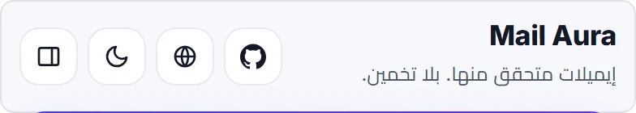

العنوان ومختر اللغة وتبديل الثيم ورابط GitHub وزر اللوحة الجانبية كلها في صف واحد مدمج.

### 3.2 إجراء رئيسي واحد

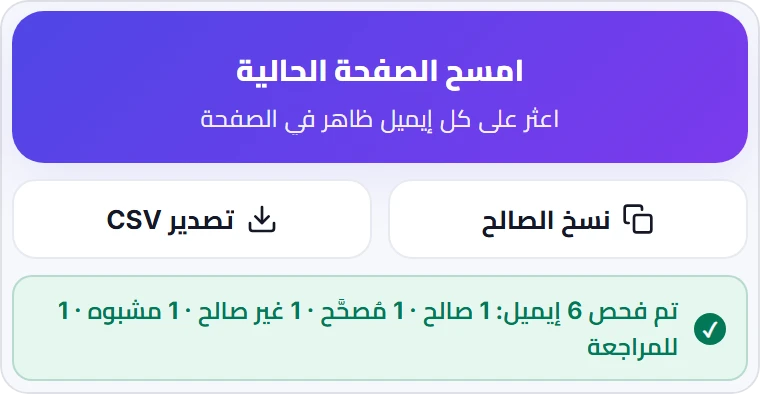

زر واحد بتدرج لوني ينجز العمل للمصدر النشط. تحته مباشرة **نسخ الصالحات** و**تصدير CSV** بنقرة واحدة؛ كما توفر شريط النتائج **نسخ النتائج المعروضة** و**مسح النتائج** وزر نسخ لكل صف. سطر الحالة يخبرك بالضبط بما حدث.

### 3.3 المصدر — الصفحة الحالية

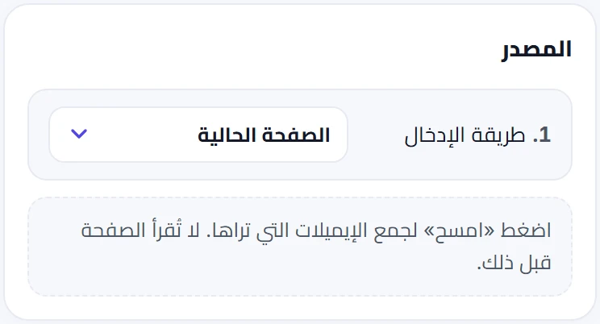

امسح فقط العناوين الظاهرة في الصفحة التي تقرأها. لا تُقرأ أي بيانات قبل أن تضغط الزر.

### 3.4 المصدر — القائمة الملصقة

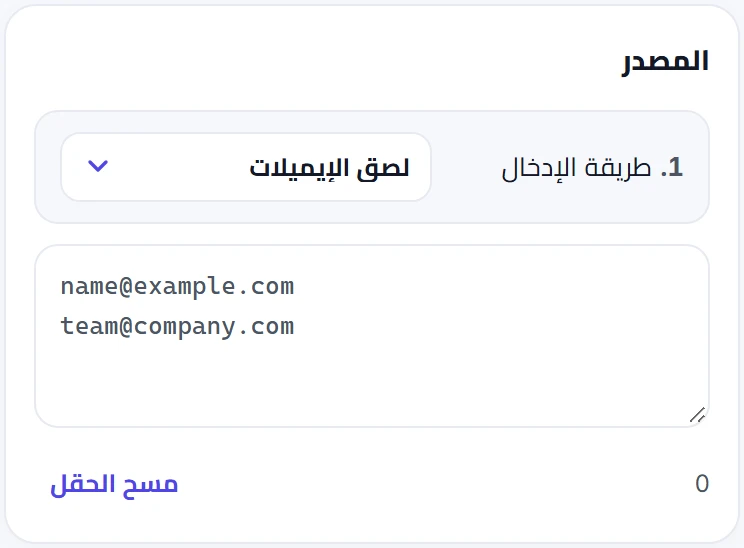

الصق عنواناً في كل سطر أو افصل بينها بفواصل. تختفي التكرارات قبل التحقق، وتبقى الأسطر غير الصحيحة ظاهرة كنتائج.

### 3.5 المصدر — ملف CSV

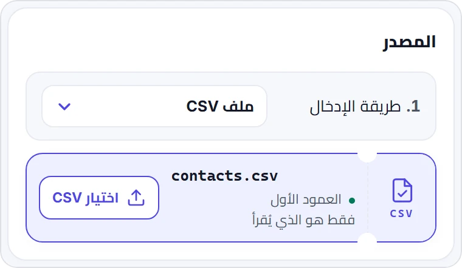

بطاقة الملف تعرض الأيقونة واسم الملف المحدد. تُقرأ الأعمدة الأولى فقط، لذا حتى التصديرات الفوضوية تعمل.

### 3.6 النتائج — جوهر المنتج

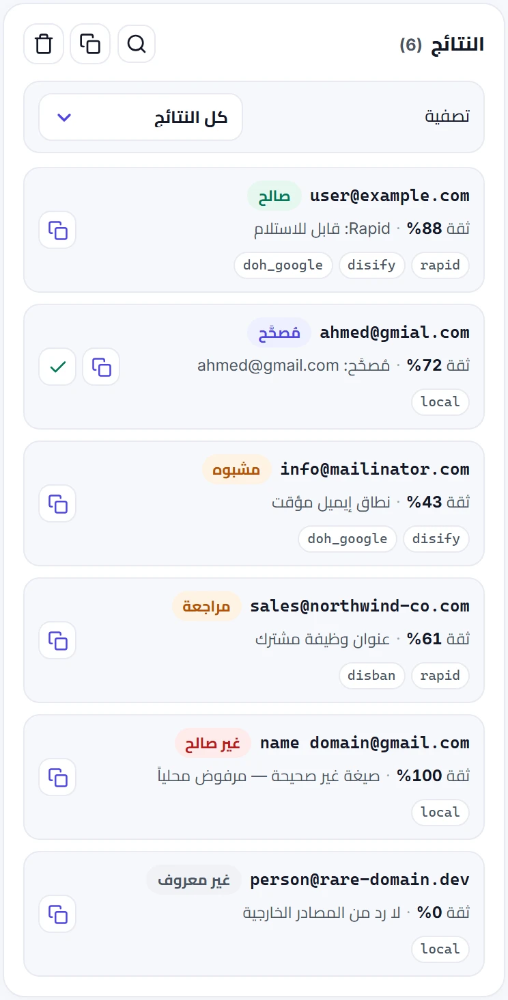

كل صف يعرض العنوان وشارة حالة ملونة وسطر سبب وإجراءات خاصة بالصف. شرائح المصادر الاختيارية تعرض معرّفات المصادر التي أجابت فعلاً.

### 3.7 التصفية والبحث

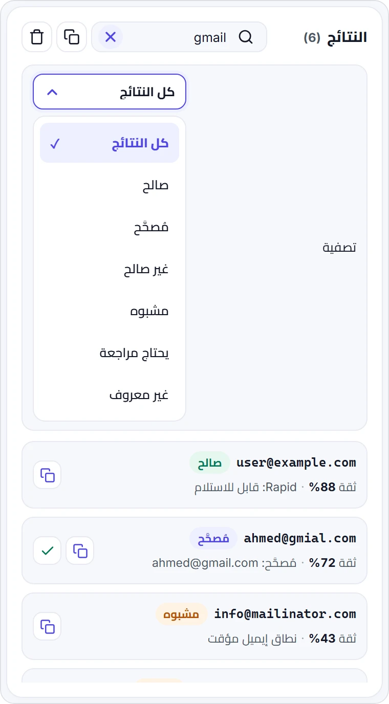

سبع حالات تصفية وحقل بحث قابل للتوسيع يعملان معاً؛ تأخير 80 مللي ثانية يحافظ على سلاسة الكتابة.

### 3.8 التحقق من قائمة السياق

حدد عنوان بريد أو رابط `mailto:` في أي صفحة ثم اختر **التحقق من عنوان البريد هذا**. تظهر النتيجة في النافذة المنبثقة مع احترام وضع الخصوصية، فلا يحدث أي اتصال خارجي عند تفعيله.

### 3.9 الإعدادات

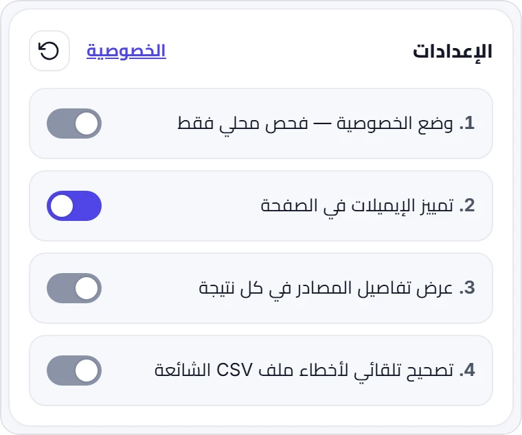

وضع الخصوصية وإبراز العناوين في الصفحة وشرائح المصادر والتصحيح التلقائي الاختياري كلها مفاتيح صريحة. التصحيح التلقائي مطفأ افتراضياً، ويصلح فقط أخطاء النطاقات المعروفة في القوائم الملصقة ومسح الصفحة وملفات CSV — بما في ذلك وضع الخصوصية. لا تُخمَّن الأخطاء غير المعروفة أو المتعددة الاحتمالات. تبديل وضع الخصوصية يمسح أيضاً ذاكرة تخزين النطاقات المؤقتة.

### 3.10 ثماني لغات وRTL حقيقي

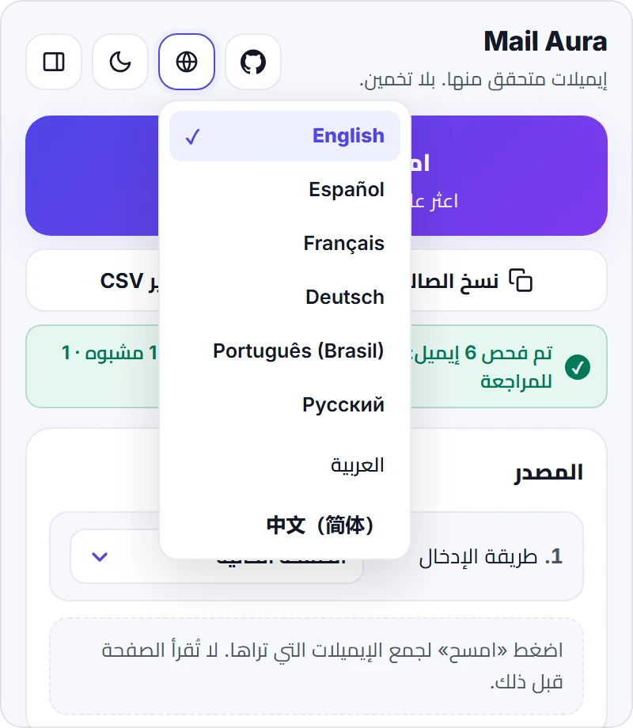

التبديل فوراً بين English وEspañol وFrançais وDeutsch وPortuguês (Brasil) وРусский والعربية و中文（简体）. العربية تعكس التخطيط بالكامل بمنطق وليس بمظهر شكلي فقط.

### 3.11 ثيم داكن أسود حقيقي

خلفية سوداء حقيقية بتباين مضبوط، تُفعّل من الرأس وتُتذكر بين الجلسات.

### 3.12 اللوحة الجانبية للقوائم الطويلة

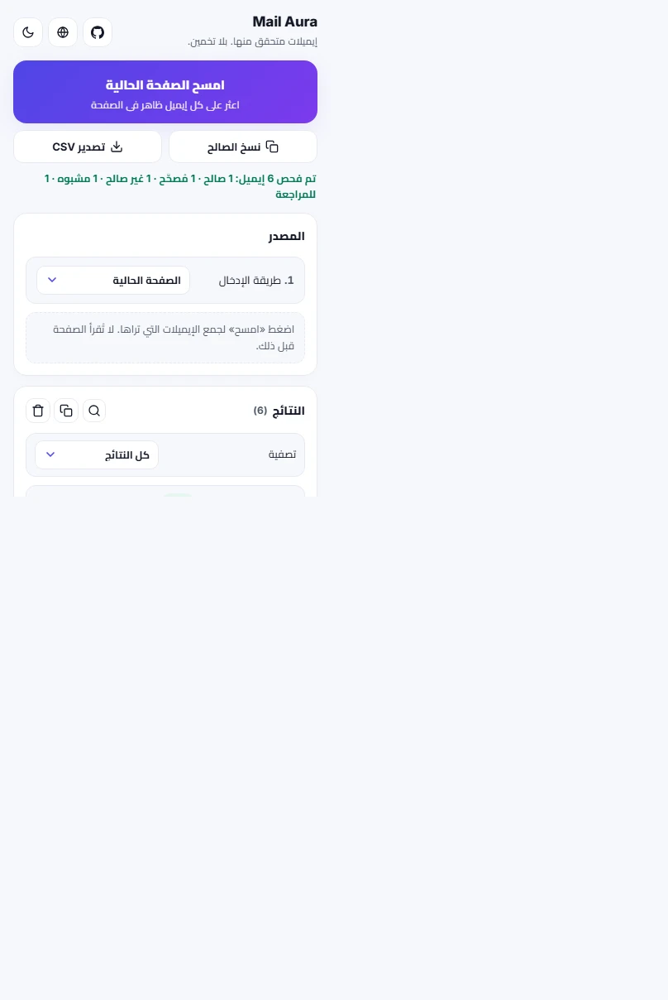

نفس المتحكم ومساحة أوسع وحاوية تمرير واحدة — بلا أشرطة تمرير متداخلة.

### 3.13 الحالة الفارغة

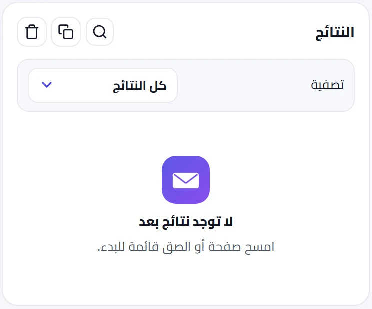

دعوة صادقة للمسح أو اللصق، وليس مربعاً فارغاً أبداً.

### 3.14 دعم التطوير المستمر

Mail Aura مجاني ومفتوح المصدر. PayPal وخيار InstaPay البارز يساعدان على تحسينه. كلاهما يُفتح في تبويب جديد، والإضافة لا ترسل أي بيانات.
## 4. ثمانية مصادر مجانية

1. Rapid Email Validator
2. Disify
3. DeBounce
4. MailCheck.ai
5. Disban
6. EmailProbe
7. Google DNS-over-HTTPS
8. Cloudflare DNS-over-HTTPS

جميع الاتصالات عبر HTTPS ودون مفتاح، ووضع الخصوصية يعطّلها جميعاً.

---

## 5. التثبيت (غير مجمّع)

1. افتح `chrome://extensions`.
2. فعّل **Developer mode**.
3. انقر **Load unpacked** واختر هذا المجلد.
4. انقر أيقونة Mail Aura في شريط الأدوات.

لا حاجة لخطوة بناء ولا إلى تبعيات خارجية.

---

## 6. التطوير

المستودع المنشور يحتوي على الإضافة ووثائقها فقط. أدوات التطوير والاختبارات المحلية مستبعدة قصداً؛ يتحقق GitHub Actions من الـ manifest وCSP وتطابق اللغات والملفات المضمّنة مع كل دفع.

---

## 7. الخصوصية

راجع `privacy.html`. لا تُرسل العناوين إلا عندما تطلب التحقق، ولا يُتتبّع أي شيء، وكل الاتصالات تستخدم HTTPS. تُحفظ نتيجة قائمة السياق مؤقتاً في storage.session حتى يقرأها الـ popup، وتُخزَّن الإعدادات محلياً. الخطوط مضمّنة محلياً ولا يوجد أي طلب خطوط خارجي.

---

## 8. الترخيص

المشروع مفتوح المصدر ومجاني للجميع بموجب ترخيص **Apache-2.0** — استخدمه، وعدّله، وشاركه بحرية؛ والنص الكامل في [LICENSE](LICENSE).

---

بُني بعناية بواسطة <b>Ahmed Yousry</b> · <a href="https://github.com/el9a7rawi/Mail-Aura">Mail Aura</a> · <a href="LICENSE">Apache-2.0</a>

