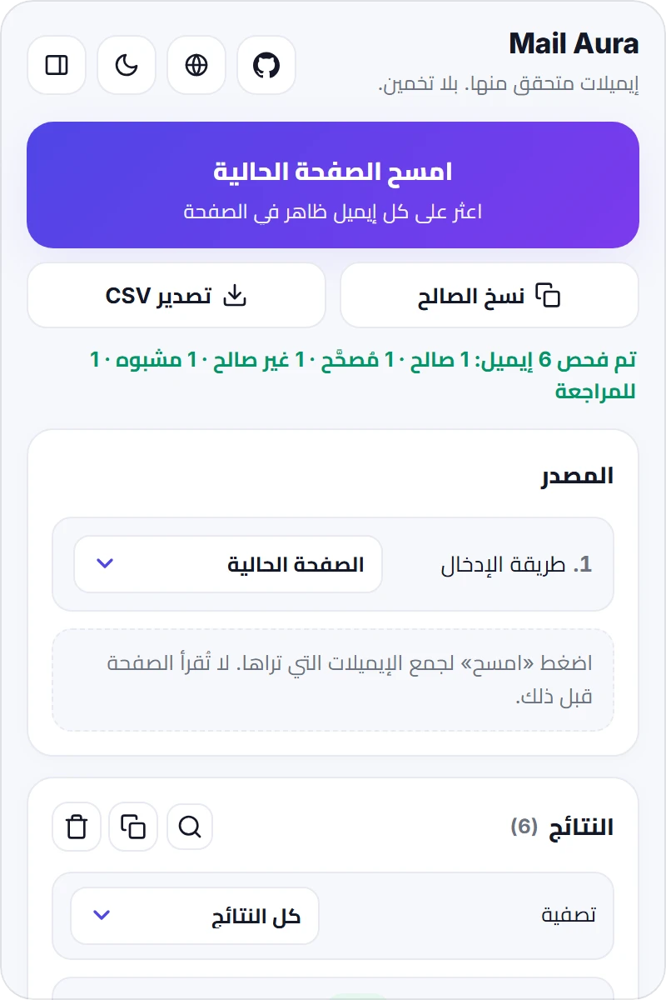

<p align="center">
  
</p>

<h1 align="center">Mail Aura — مدقّق البريد الإلكتروني ومنظّق القوائم</h1>

<p align="center">تحقّق من عناوين البريد الإلكتروني عبر ثمانية مصادر عامة مجانية، ونظّف القوائم الطويلة بنقرة واحدة، وصدّر النتائج بصيغة CSV — بلا مفتاح API، ولا حساب، ولا تخمين. تأتي الواجهة بثماني لغات، منها دعم RTL كامل للعربية.</p>

<p align="center">
  <a href="https://github.com/el9a7rawi/Mail-Aura/releases"></a>
  <a href="https://github.com/el9a7rawi/Mail-Aura/blob/main/LICENSE"></a>
  <a href="https://github.com/el9a7rawi/Mail-Aura/pulls"></a>
  <a href="https://developer.chrome.com/docs/extensions"></a>
  
  
</p>

<p align="center">
  <sub><b>اللغات:</b> <a href="README.md">English</a> · <a href="README.es.md">Español</a> · <a href="README.fr.md">Français</a> · <a href="README.de.md">Deutsch</a> · <a href="README.pt-BR.md">Português (Brasil)</a> · <a href="README.ru.md">Русский</a> · <a href="README.ar.md"><b>العربية</b></a> · <a href="README.zh-CN.md">中文（简体）</a></sub>
</p>
<h3 align="center">Download for your browser — click the icon</h3>

<div align="center">

| [<br><b>Chrome</b>](https://github.com/el9a7rawi/Mail-Aura/releases/latest) | [<br><b>Edge</b>](https://github.com/el9a7rawi/Mail-Aura/releases/latest) | [<br><b>Firefox</b>](https://github.com/el9a7rawi/Mail-Aura/releases/latest) | [<br><b>Brave</b>](https://github.com/el9a7rawi/Mail-Aura/releases/latest) | [<br><b>Opera</b>](https://github.com/el9a7rawi/Mail-Aura/releases/latest) |
|---|---|---|---|---|

</div>


<p align="center">
  
</p>

---

## 1. لماذا Mail Aura؟

<div align="center">

| بدون Mail Aura | مع Mail Aura |
|---|---|
| التخمين بناءً على الشكل فقط | ثمانية مصادر مستقلة إضافةً إلى إشارات محلية |
| قوائم ملصقة مليئة بالتكرارات | تُزال التكرارات قبل التحقق |
| تنظيف يدوي لملفات CSV | استيراد وتصدير CSV بنقرة واحدة |
| شارة 100% لا تعني شيئاً | درجة صادقة لا تتجاوز 88% للعناوين الصحيحة |

</div>

لا تستطيع أي خدمة عامة أن تثبت وجود صندوق بريد بعينه دون إرسال رسالة فعلية إليه. لذلك يعرض Mail Aura **درجة ثقة** لا ضماناً.

---

## 2. كيف يعمل — ثلاث خطوات

1. **اختر مصدراً** — امسح الصفحة الحالية، أو الصق قائمة، أو حمّل ملف CSV.
2. **تحقّق** — تُفحص العناوين بالتوازي مقابل ثماني خدمات مجانية، مع تخزين النتائج مؤقتاً حسب النطاق.
3. **تصرّف** — انسخ العناوين الصحيحة، أو صحّح الأخطاء الإملائية بنقرة واحدة، أو صدّر كل شيء بصيغة CSV.

---

## 3. جولة في الواجهة

### 3.1 إجراء رئيسي واحد، وثلاثة أنماط للإدخال
- **مسح هذه الصفحة** — يجمع العناوين الظاهرة ويُبرزها دون قراءة الصفحة مسبقاً.
- **لصق العناوين** — عنوان في كل سطر أو مفصولة بفواصل؛ تُزال التكرارات ويظهر التنسيق غير الصالح كنتيجة.
- **ملف CSV** — يقرأ العمود الأول ويُصدّر ملف CSV جديداً يحتوي على الحالة، ودرجة الثقة، ودرجة الاتفاق، والاقتراح، وتفاصيل المصدر.

### 3.2 نتائج يمكنك الوثوق بها
- يعرض كل صف العنوان، وشارة الحالة، وسطر تفاصيل موجز: `Confidence N% · reason`.
- تصفية حسب الحالة، والبحث داخل النتائج، ونسخ الصفوف الصحيحة أو الظاهرة.
- تصحيح الأخطاء الإملائية المعروفة في النطاقات مثل `gmial.com → gmail.com` بنقرة واحدة.
- تُوسَم نطاقات البريد المؤقتة وعناوين الأدوار والمزوّدون المجانيون بدل أن تُخفى.

### 3.3 وضع الخصوصية
- يوقف كل الاتصالات الخارجية فوراً؛ فيصبح التحقق محلياً فقط.
- يعرض مؤشر الاتصال في التذييل الحالة الحالية دائماً.

### 3.4 ثماني لغات، ودعم RTL حقيقي
- الإنجليزية هي الافتراضية، وتُستخدم لغة المتصفح عند التشغيل الأول إن كانت ضمن اللغات الثماني.
- التبديل فوري ولا يتطلب إعادة تحميل.
- تستخدم العربية تخطيط RTL كاملاً مع قواعد الجمع الصحيحة.

### 3.5 ثيم داكن بأسود حقيقي
- خلفية سوداء فعلية مع تباين مضبوط، تُبدَّل من أعلى الواجهة ويُتذكّر اختيارك.

### 3.6 ادعم استمرار التطوير

- Mail Aura مجاني ومفتوح المصدر. زر InstaPay اختياري وبديل PayPal يساعدان على استمرار تحسينه. كلا الرابطين يفتحان في تبويب جديد والإضافة لا ترسل أي بيانات.

---

## 4. ثمانية مصادر مجانية

1. Rapid Email Validator
2. Disify
3. DeBounce
4. MailCheck.ai
5. Disban
6. EmailProbe
7. Google DNS-over-HTTPS
8. Cloudflare DNS-over-HTTPS

جميع الاتصالات عبر HTTPS ودون مفتاح، ووضع الخصوصية يعطّلها جميعاً.

---

## 5. التثبيت (غير مجمّع)

1. افتح `chrome://extensions`.
2. فعّل **Developer mode**.
3. انقر **Load unpacked** واختر هذا المجلد.
4. انقر أيقونة Mail Aura في شريط الأدوات.

لا حاجة لخطوة بناء ولا إلى تبعيات خارجية.

---

## 6. التطوير

```powershell
node --test tests/             # 49 unit tests
node --check ui.js             # syntax check for every JS file
node scripts/check-ui.mjs      # DOM ids, manifest files, CSP, HTTPS
node scripts/build-preview.mjs # regenerate dev/preview.html and preview-side.html
```

يلزم وجود Chrome لأداة التقاط اللقطات:

```powershell
node scripts/screenshot.mjs --url "file:///C:/.../dev/preview.html?theme=light&tall=1" --out dev/preview-light.png
```

---

## 7. الخصوصية

راجع `privacy.html`. لا تُرسل العناوين إلا عندما تطلب التحقق، ولا يُتتبّع أي شيء، وكل الاتصالات تستخدم HTTPS. الاستثناء الوحيد المُعلَن هو ورقة أنماط واحدة من Google Fonts تُحمّل عند فتح الواجهة، ولا يُرسل معها أي بيانات بريد أو تحقق.

---

## 8. الترخيص

المشروع مفتوح المصدر ومجاني للجميع بموجب ترخيص **Apache-2.0** — استخدمه، وعدّله، وشاركه بحرية؛ والنص الكامل في [LICENSE](LICENSE).

---

<p align="center">بُني بعناية بواسطة <b>Ahmed Yousry</b> · <a href="https://github.com/el9a7rawi/Mail-Aura">Mail Aura</a> · <a href="LICENSE">Apache-2.0</a></p>
