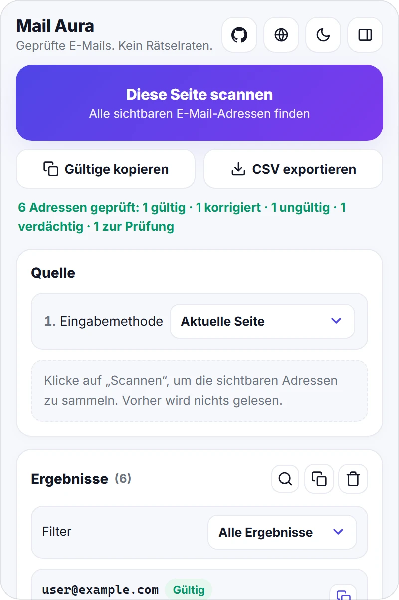
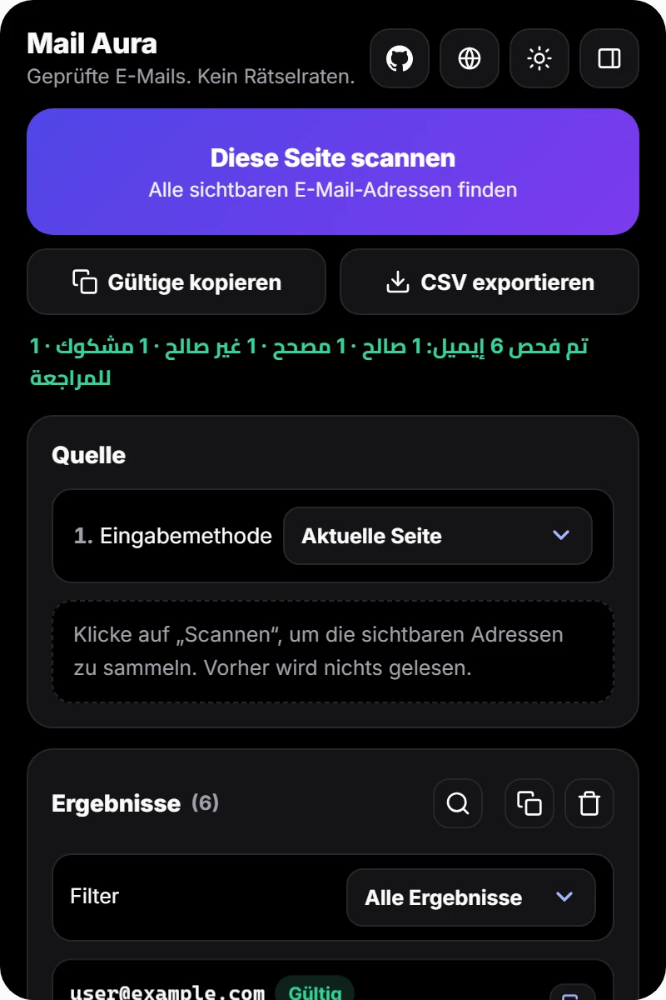

<p align="center">
  
</p>

<h1 align="center">Mail Aura — E-Mail-Verifizierer & Listenbereiniger</h1>

<p align="center">Überprüfen Sie E-Mail-Adressen anhand von acht kostenlosen öffentlichen Quellen, bereinigen Sie lange Listen mit einem Klick und exportieren Sie die Ergebnisse als CSV — ohne API-Schlüssel, ohne Konto und ohne Rätselraten. Die Oberfläche ist in acht Sprachen verfügbar, einschließlich vollständigem Arabisch-RTL.</p>

<p align="center">
  <a href="https://github.com/el9a7rawi/Mail-Aura/releases"></a>
  <a href="https://github.com/el9a7rawi/Mail-Aura/blob/main/LICENSE"></a>
  <a href="https://github.com/el9a7rawi/Mail-Aura/pulls"></a>
  <a href="https://developer.chrome.com/docs/extensions"></a>
  
  
</p>

<p align="center">
  <sub><b>Sprachen:</b> <a href="README.md">English</a> · <a href="README.es.md">Español</a> · <a href="README.fr.md">Français</a> · <a href="README.de.md"><b>Deutsch</b></a> · <a href="README.pt-BR.md">Português (Brasil)</a> · <a href="README.ru.md">Русский</a> · <a href="README.ar.md">العربية</a> · <a href="README.zh-CN.md">中文（简体）</a></sub>
</p>
<h3 align="center">Download for your browser — click the icon</h3>

<div align="center">

| [<br><b>Chrome</b>](https://github.com/el9a7rawi/Mail-Aura/releases/latest) | [<br><b>Edge</b>](https://github.com/el9a7rawi/Mail-Aura/releases/latest) | [<br><b>Firefox</b>](https://github.com/el9a7rawi/Mail-Aura/releases/latest) | [<br><b>Brave</b>](https://github.com/el9a7rawi/Mail-Aura/releases/latest) | [<br><b>Opera</b>](https://github.com/el9a7rawi/Mail-Aura/releases/latest) |
|---|---|---|---|---|

</div>


<p align="center">
  
  
</p>

---

## 1. Warum Mail Aura?

<div align="center">

| Ohne Mail Aura | Mit Mail Aura |
|---|---|
| Allein anhand des Formats raten | Acht unabhängige Quellen plus lokale Signale |
| Eingefügte Listen voller Duplikate | Duplikate vor der Überprüfung entfernt |
| Manuelle CSV-Bereinigung | CSV-Import und -Export mit einem Klick |
| Ein 100%-Abzeichen, das nichts bedeutet | Ein ehrlicher Wert, der für gültige Adressen bei 88 % begrenzt ist |

</div>

Kein öffentlicher Dienst kann nachweisen, dass ein bestimmtes Postfach existiert, ohne tatsächlich eine E-Mail zu versenden. Mail Aura meldet daher einen **Konfidenzwert**, keine Garantie.

---

## 2. So funktioniert es — drei Schritte

1. **Quelle wählen** — die aktuelle Seite scannen, eine Liste einfügen oder eine CSV laden.
2. **Überprüfen** — Adressen werden parallel anhand von acht kostenlosen Diensten geprüft und nach Domain zwischengespeichert.
3. **Handeln** — gültige Adressen kopieren, Tippfehler mit einem Klick korrigieren oder alles als CSV exportieren.

---

## 3. Oberflächenrundgang

### 3.1 Eine Hauptaktion, drei Eingabemodi
- **Diese Seite scannen** — sammelt sichtbare Adressen und hebt sie hervor, ohne die Seite vorher zu lesen.
- **Adressen einfügen** — eine pro Zeile oder durch Kommas getrennt; Duplikate werden entfernt und ungültige Syntax als Ergebnis angezeigt.
- **CSV-Datei** — liest die erste Spalte und exportiert eine neue CSV mit Status, Konfidenz, Übereinstimmung, Vorschlag und Quelldetails.

### 3.2 Ergebnisse, denen Sie vertrauen können
- Jede Zeile zeigt die Adresse, ein Statusabzeichen und eine kurze Detailzeile: `Konfidenz N % · Grund`.
- Nach Status filtern, in den Ergebnissen suchen und gültige oder sichtbare Zeilen kopieren.
- Bekannte Domain-Tippfehler wie `gmial.com → gmail.com` mit einem einzigen Klick korrigieren.
- Wegwerf-Domains, Rollenadressen und kostenlose Anbieter werden markiert statt ausgeblendet.

### 3.3 Datenschutzmodus
- Beendet jeden externen Aufruf sofort; die Überprüfung erfolgt nur noch lokal.
- Die Verbindungsanzeige in der Fußzeile zeigt immer den aktuellen Status.

### 3.4 Acht Sprachen, echtes RTL
- Englisch ist die Standardsprache; beim ersten Start wird die Browsersprache verwendet, wenn sie eine der acht ist.
- Der Wechsel erfolgt sofort und erfordert kein Neuladen.
- Arabisch verwendet ein vollständiges RTL-Layout mit korrekten Pluralregeln.

### 3.5 Echtes Schwarz im dunklen Design
- Ein wirklich schwarzer Hintergrund mit abgestimmtem Kontrast, umschaltbar über die Kopfzeile und gespeichert.

---

## 4. Acht kostenlose Quellen

1. Rapid Email Validator
2. Disify
3. DeBounce
4. MailCheck.ai
5. Disban
6. EmailProbe
7. Google DNS-over-HTTPS
8. Cloudflare DNS-over-HTTPS

Alle Aufrufe erfolgen über HTTPS und ohne Schlüssel. Der Datenschutzmodus deaktiviert sie alle.

---

## 5. Installation (entpackt)

1. Öffnen Sie `chrome://extensions`.
2. Aktivieren Sie den **Entwicklermodus**.
3. Klicken Sie auf **Entpackte Erweiterung laden** und wählen Sie diesen Ordner.
4. Klicken Sie auf das Mail Aura-Symbol in der Symbolleiste.

Es ist kein Build-Schritt und sind keine externen Abhängigkeiten erforderlich.

---

## 6. Entwicklung

```powershell
node --test tests/             # 49 Unit-Tests
node --check ui.js             # Syntaxprüfung für jede JS-Datei
node scripts/check-ui.mjs      # DOM-IDs, Manifestdateien, CSP, HTTPS
node scripts/build-preview.mjs # dev/preview.html und preview-side.html neu erzeugen
```

Für das Screenshot-Hilfsprogramm ist Chrome erforderlich:

```powershell
node scripts/screenshot.mjs --url "file:///C:/.../dev/preview.html?theme=light&tall=1" --out dev/preview-light.png
```

---

## 7. Datenschutz

Siehe `privacy.html`. Adressen werden nur versendet, wenn Sie eine Überprüfung anfordern, es wird nichts verfolgt und alle Verbindungen nutzen HTTPS. Die einzige deklarierte Ausnahme ist ein einzelnes Google-Fonts-Stylesheet, das beim Öffnen der Oberfläche geladen wird; damit werden keine E-Mail- oder Überprüfungsdaten übermittelt.

---

## 8. Lizenz

Das Projekt ist Open Source und für alle unter der **Apache-2.0**-Lizenz kostenlos — nutzen, ändern und teilen Sie es frei; der vollständige Text befindet sich in [LICENSE](LICENSE).

---

<p align="center">Mit Sorgfalt erstellt von <b>Ahmed Yousry</b> · <a href="https://github.com/el9a7rawi/Mail-Aura">Mail Aura</a> · <a href="LICENSE">Apache-2.0</a></p>
