<p align="center">
  
</p>

<h1 align="center">Mail Aura — E-Mail-Verifizierer & Listenbereiniger</h1>

<p align="center">Überprüfen Sie E-Mail-Adressen anhand von acht kostenlosen öffentlichen Quellen, bereinigen Sie lange Listen mit einem Klick und exportieren Sie die Ergebnisse als CSV — ohne API-Schlüssel, ohne Konto und ohne Rätselraten. Die Oberfläche ist in acht Sprachen verfügbar, einschließlich vollständigem Arabisch-RTL.</p>

<p align="center">
  <a href="https://github.com/el9a7rawi/Mail-Aura/releases"></a>
  <a href="https://github.com/el9a7rawi/Mail-Aura/blob/main/LICENSE"></a>
  <a href="https://github.com/el9a7rawi/Mail-Aura/pulls"></a>
  <a href="https://developer.chrome.com/docs/extensions"></a>
  
  
</p>

<h4 align="center">
  <a href="README.md">English</a> · <a href="README.es.md">Español</a> · <a href="README.fr.md">Français</a> · <a href="README.de.md"><b>Deutsch</b></a> · <a href="README.pt-BR.md">Português (Brasil)</a> · <a href="README.ru.md">Русский</a> · <a href="README.ar.md">العربية</a> · <a href="README.zh-CN.md">中文（简体）</a>
</h4>
<h3 align="center">Download for your browser — click the icon</h3>

<div align="center">

| [<br><b>Chrome</b>](https://github.com/el9a7rawi/Mail-Aura/releases/latest) | [<br><b>Edge</b>](https://github.com/el9a7rawi/Mail-Aura/releases/latest) | [<br><b>Firefox</b>](https://github.com/el9a7rawi/Mail-Aura/releases/latest) | [<br><b>Brave</b>](https://github.com/el9a7rawi/Mail-Aura/releases/latest) | [<br><b>Opera</b>](https://github.com/el9a7rawi/Mail-Aura/releases/latest) |

Chrome und Chromium-Browser sind das Hauptziel. Firefox wird ab Version 140 über ein eigenes Archiv mit Firefox-spezifischem Manifest (Seitenleisten-Aktion und klassisches Hintergrundskript) unterstützt.
|---|---|---|---|---|

</div>

---

## 1. Warum Mail Aura?

<div align="center">

| Ohne Mail Aura | Mit Mail Aura |
|---|---|
| Allein anhand des Formats raten | Acht unabhängige Quellen plus lokale Signale |
| Eingefügte Listen voller Duplikate | Duplikate vor der Überprüfung entfernt |
| Manuelle CSV-Bereinigung | CSV-Import und -Export mit einem Klick |
| Ein 100%-Abzeichen, das nichts bedeutet | Ein ehrlicher Wert, der für gültige Adressen bei 88 % begrenzt ist |

</div>

Kein öffentlicher Dienst kann nachweisen, dass ein bestimmtes Postfach existiert, ohne tatsächlich eine E-Mail zu versenden. Mail Aura meldet daher einen **Konfidenzwert**, keine Garantie.

---

## 2. So funktioniert es — drei Schritte

1. **Quelle wählen** — die aktuelle Seite scannen, eine Liste einfügen oder eine CSV laden.
2. **Überprüfen** — Adressen werden parallel anhand von acht kostenlosen Diensten geprüft und nach Domain zwischengespeichert.
3. **Handeln** — gültige Adressen kopieren, Tippfehler mit einem Klick korrigieren oder alles als CSV exportieren.

---

## 3. Oberflächen-Rundgang — jeder Teil der Erweiterung

### 3.1 Kopfzeile — alles erreichbar
<p align="center">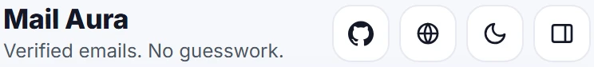</p>

Titel, Sprachauswahl, Theme-Umschalter, GitHub-Link und Seitenleisten-Button sitzen in einer einzigen kompakten Zeile.

### 3.2 Eine Hauptaktion
<p align="center">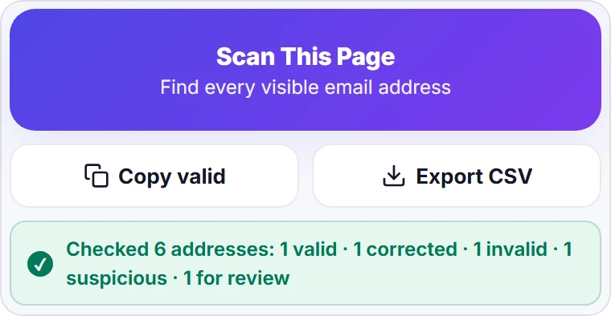</p>

Eine einzige Verlaufstaste erledigt die Arbeit für die aktive Quelle. Darunter sind **Gültige kopieren** und **CSV exportieren** einen Klick entfernt; die Ergebnisleiste bietet außerdem **Angezeigte Ergebnisse kopieren**, **Ergebnisse löschen** und eine Kopierschaltfläche pro Zeile. Die Statuszeile sagt genau, was passiert ist.

### 3.3 Quelle — aktuelle Seite
<p align="center">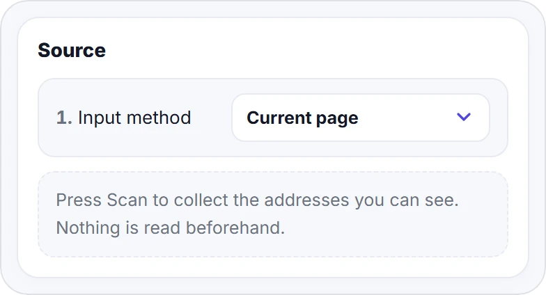</p>

Es werden nur die auf der aktuellen Seite sichtbaren Adressen gescannt. Nichts wird gelesen, bevor Sie die Taste drücken.

### 3.4 Quelle — eingefügte Liste
<p align="center">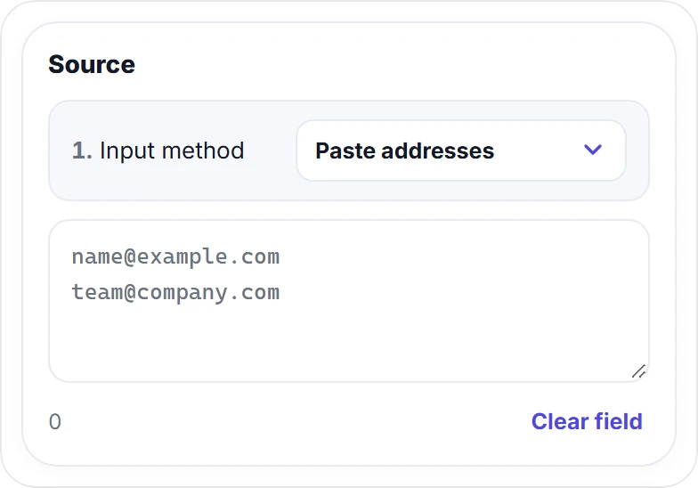</p>

Eine Adresse pro Zeile oder mit Kommas getrennt einfügen. Duplikate verschwinden vor der Prüfung; fehlerhafte Zeilen bleiben als Ergebnisse sichtbar.

### 3.5 Quelle — CSV-Datei
<p align="center">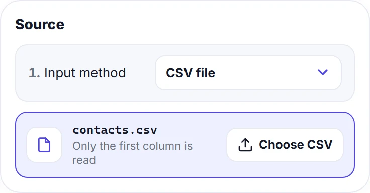</p>

Eine Dateikarte zeigt Symbol und Dateinamen. Es wird nur die erste Spalte gelesen, sodass auch unordentliche Exporte funktionieren.

### 3.6 Ergebnisse — das Kernstück
<p align="center">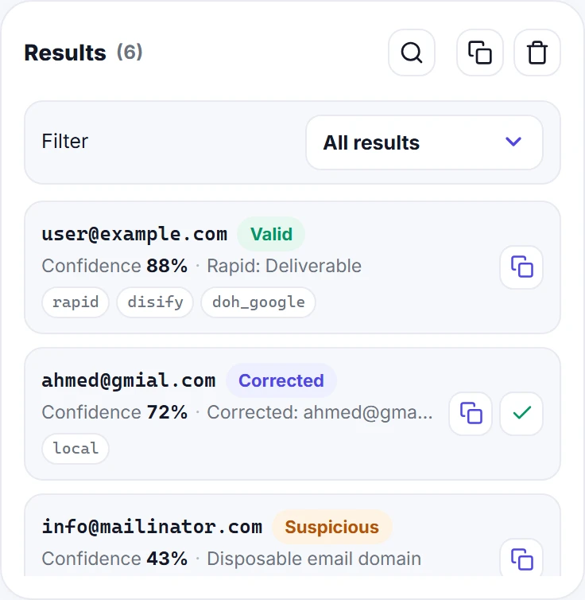</p>

Jede Zeile zeigt die Adresse, ein farbiges Statussymbol, eine Begründung und Aktionen pro Zeile. Optionale Quellen-Chips zeigen die Bezeichnungen der tatsächlich antwortenden Dienste.

### 3.7 Filter und Suche
<p align="center">
  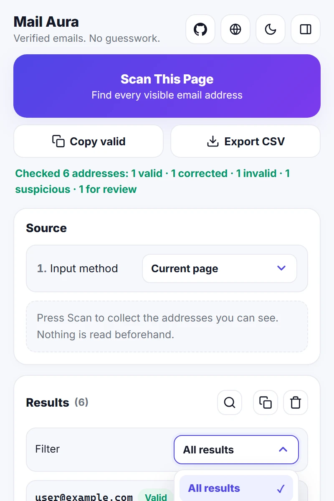
  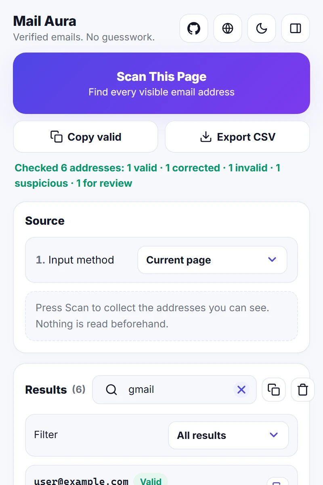
</p>

Sieben Filterzustände und ein ausklappbares Suchfeld arbeiten zusammen; eine Verzögerung von 80 ms hält die Eingabe flüssig.

### 3.8 Prüfung über das Kontextmenü

Markieren Sie eine Adresse oder einen `mailto:`-Link auf einer beliebigen Seite und wählen Sie **Diese E-Mail-Adresse prüfen**. Das Ergebnis öffnet sich im Popup und beachtet den Datenschutzmodus: Ist er aktiv, findet kein externer Aufruf statt.

### 3.9 Einstellungen
<p align="center">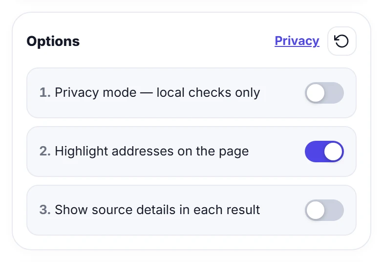</p>

Datenschutzmodus, Hervorhebung auf der Seite, Quellen-Chips und die optionale CSV-Autokorrektur sind ausdrückliche Schalter. Die Autokorrektur ist standardmäßig aus und korrigiert nur bekannte Domain-Tippfehler in hochgeladenen CSVs; unbekannte Fehler werden nie geraten. Das Umschalten des Datenschutzmodus leert außerdem den Domain-Cache im Speicher.

### 3.10 Acht Sprachen, echtes RTL
<p align="center"></p>

Sofortiger Wechsel zwischen English, Español, Français, Deutsch, Português (Brasil), Русский, العربية und 中文（简体）. Arabisch kehrt das gesamte Layout logisch um, nicht nur optisch.

### 3.11 Tiefschwarzes Dunkeldesign

Ein wirklich schwarzer Hintergrund mit abgestimmtem Kontrast, umschaltbar in der Kopfzeile und über Sitzungen hinweg gespeichert.

### 3.12 Seitenleiste für lange Listen
<p align="center">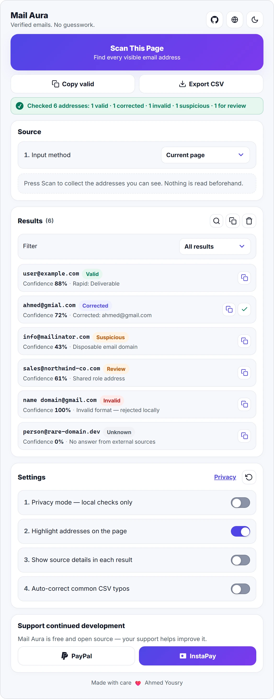</p>

Derselbe Controller, eine breitere Fläche und ein einziger Scroll-Bereich — keine verschachtelten Scrollleisten.

### 3.13 Leerer Zustand
<p align="center">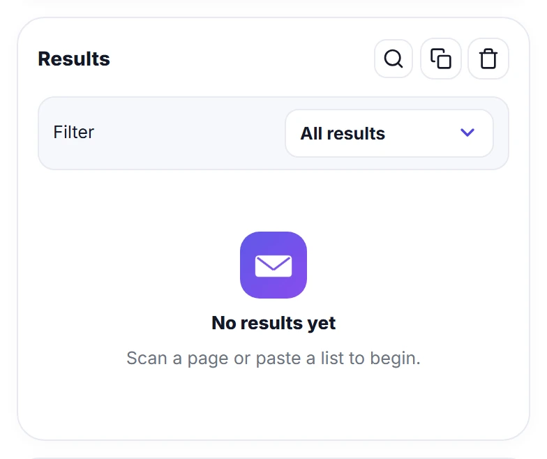</p>

Eine ehrliche Einladung zum Scannen oder Einfügen, nie eine leere Box.

### 3.14 Weiterentwicklung unterstützen
<p align="center">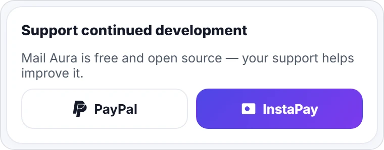</p>

Mail Aura ist kostenlos und Open Source. PayPal und eine hervorgehobene InstaPay-Option helfen bei der Weiterentwicklung. Beide öffnen in einem neuen Tab; die Erweiterung sendet keine Daten.
## 4. Acht kostenlose Quellen

1. Rapid Email Validator
2. Disify
3. DeBounce
4. MailCheck.ai
5. Disban
6. EmailProbe
7. Google DNS-over-HTTPS
8. Cloudflare DNS-over-HTTPS

Alle Aufrufe erfolgen über HTTPS und ohne Schlüssel. Der Datenschutzmodus deaktiviert sie alle.

---

## 5. Installation (entpackt)

1. Öffnen Sie `chrome://extensions`.
2. Aktivieren Sie den **Entwicklermodus**.
3. Klicken Sie auf **Entpackte Erweiterung laden** und wählen Sie diesen Ordner.
4. Klicken Sie auf das Mail Aura-Symbol in der Symbolleiste.

Es ist kein Build-Schritt und sind keine externen Abhängigkeiten erforderlich.

---

## 6. Entwicklung

```powershell
node --test tests/
node --check ui.js             # Syntaxprüfung für jede JS-Datei
node scripts/check-ui.mjs      # DOM-IDs, Manifestdateien, CSP, HTTPS
node scripts/build-preview.mjs # dev/preview.html und preview-side.html neu erzeugen
```

Für das Screenshot-Hilfsprogramm ist Chrome erforderlich:

```powershell
node scripts/screenshot.mjs --url "file:///C:/.../dev/preview.html?theme=light&tall=1" --out dev/preview-light.png
```

---

## 7. Datenschutz

Siehe `privacy.html`. Adressen werden nur versendet, wenn Sie eine Überprüfung anfordern, es wird nichts verfolgt und alle Verbindungen nutzen HTTPS. Die Schriften sind lokal gebündelt; es verlässt keine Schriftanfrage die Erweiterung.

---

## 8. Lizenz

Das Projekt ist Open Source und für alle unter der **Apache-2.0**-Lizenz kostenlos — nutzen, ändern und teilen Sie es frei; der vollständige Text befindet sich in [LICENSE](LICENSE).

---

<p align="center">Mit Sorgfalt erstellt von <b>Ahmed Yousry</b> · <a href="https://github.com/el9a7rawi/Mail-Aura">Mail Aura</a> · <a href="LICENSE">Apache-2.0</a></p>
