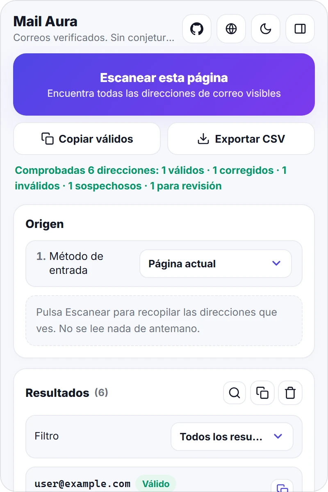
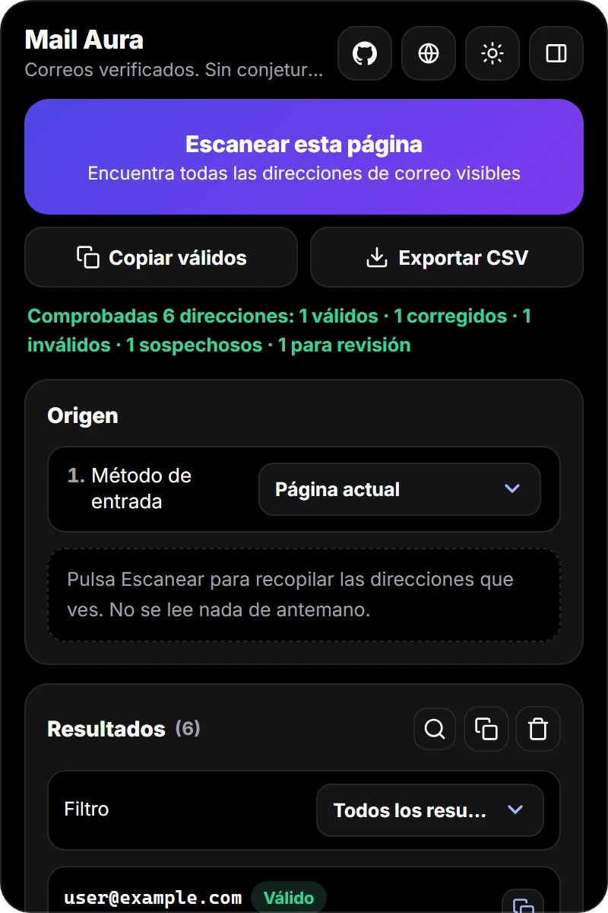
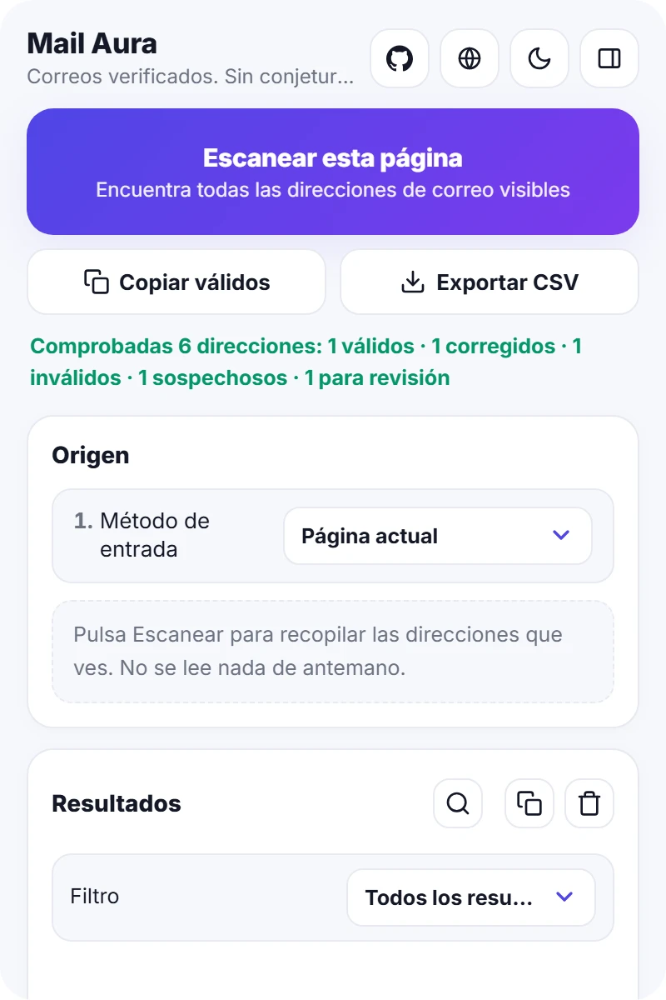
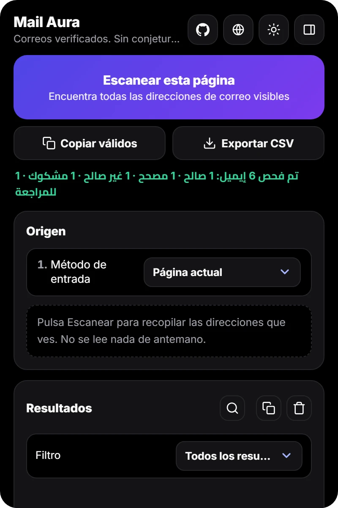

<p align="center">
  
</p>

<h1 align="center">Mail Aura — Verificador de correos y limpiador de listas</h1>

<p align="center">Verifica direcciones de correo electrónico con ocho fuentes públicas gratuitas, limpia listas largas con un clic y exporta los resultados como CSV — sin clave de API, sin cuenta y sin conjeturas. La interfaz está disponible en ocho idiomas, incluido el RTL completo en árabe.</p>

<p align="center">
  <a href="https://github.com/el9a7rawi/Mail-Aura/releases"></a>
  <a href="https://github.com/el9a7rawi/Mail-Aura/blob/main/LICENSE"></a>
  <a href="https://github.com/el9a7rawi/Mail-Aura/pulls"></a>
  <a href="https://developer.chrome.com/docs/extensions"></a>
  
  
</p>

<p align="center">
  <sub><b>Idiomas:</b> <a href="README.md">English</a> · <a href="README.es.md"><b>Español</b></a> · <a href="README.fr.md">Français</a> · <a href="README.de.md">Deutsch</a> · <a href="README.pt-BR.md">Português (Brasil)</a> · <a href="README.ru.md">Русский</a> · <a href="README.ar.md">العربية</a> · <a href="README.zh-CN.md">中文（简体）</a></sub>
</p>
<h3 align="center">Download for your browser — click the icon</h3>

<div align="center">

| [<br><b>Chrome</b>](https://github.com/el9a7rawi/Mail-Aura/releases/latest) | [<br><b>Edge</b>](https://github.com/el9a7rawi/Mail-Aura/releases/latest) | [<br><b>Firefox</b>](https://github.com/el9a7rawi/Mail-Aura/releases/latest) | [<br><b>Brave</b>](https://github.com/el9a7rawi/Mail-Aura/releases/latest) | [<br><b>Opera</b>](https://github.com/el9a7rawi/Mail-Aura/releases/latest) |
|---|---|---|---|---|

</div>


<p align="center">
  
  
</p>

<p align="center">
  
  
</p>

---

## 1. ¿Por qué Mail Aura?

<div align="center">

| Sin Mail Aura | Con Mail Aura |
|---|---|
| Adivinar solo por el formato | Ocho fuentes independientes más señales locales |
| Listas pegadas llenas de duplicados | Duplicados eliminados antes de la verificación |
| Limpieza manual de CSV | Importación y exportación de CSV con un clic |
| Una insignia del 100 % que no significa nada | Una puntuación honesta limitada al 88 % para direcciones válidas |

</div>

Ningún servicio público puede demostrar que un buzón específico existe sin enviar un correo real. Por eso, Mail Aura muestra una **puntuación de confianza**, no una garantía.

---

## 2. Cómo funciona — tres pasos

1. **Elige una fuente** — escanea la página actual, pega una lista o carga un CSV.
2. **Verifica** — las direcciones se comprueban en paralelo con ocho servicios gratuitos y se almacenan en caché por dominio.
3. **Actúa** — copia las direcciones válidas, corrige errores tipográficos con un clic o exporta todo como CSV.

---

## 3. Recorrido por la interfaz

### 3.1 Una acción principal, tres modos de entrada
- **Escanear esta página** — recopila las direcciones visibles y las resalta sin leer la página de antemano.
- **Pegar direcciones** — una por línea o separadas por comas; se eliminan los duplicados y la sintaxis inválida se muestra como resultado.
- **Archivo CSV** — lee la primera columna y exporta un nuevo CSV con estado, confianza, coincidencia, sugerencia y detalles de la fuente.

### 3.2 Resultados en los que puedes confiar
- Cada fila muestra la dirección, una insignia de estado y una línea de detalle breve: `Confianza N % · motivo`.
- Filtra por estado, busca entre los resultados y copia las filas válidas o visibles.
- Corrige errores tipográficos conocidos en dominios como `gmial.com → gmail.com` con un solo clic.
- Los dominios desechables, las direcciones de rol y los proveedores gratuitos se señalan, no se ocultan.

### 3.3 Modo privacidad
- Detiene al instante todas las llamadas externas; la verificación pasa a ser solo local.
- El indicador de conexión en el pie de página muestra siempre el estado actual.

### 3.4 Ocho idiomas, RTL real
- El inglés es el predeterminado; en el primer uso se emplea el idioma del navegador si es uno de los ocho.
- El cambio es instantáneo y no requiere recargar.
- El árabe usa un diseño RTL completo con reglas de plural correctas.

### 3.5 Tema oscuro negro real
- Un fondo realmente negro con contraste ajustado, que se activa desde la cabecera y se recuerda.

### 3.6 Support continued development

- Mail Aura es gratis y de código abierto. Un botón opcional de InstaPay y PayPal como alternativa ayudan a mejorarlo. Ambos enlaces se abren en una pestaña nueva y la extensión no envía datos.

---

## 4. Ocho fuentes gratuitas

1. Rapid Email Validator
2. Disify
3. DeBounce
4. MailCheck.ai
5. Disban
6. EmailProbe
7. Google DNS-over-HTTPS
8. Cloudflare DNS-over-HTTPS

Todas las llamadas usan HTTPS y no requieren clave. El modo privacidad las desactiva todas.

---

## 5. Instalación (sin empaquetar)

1. Abre `chrome://extensions`.
2. Activa el **modo de desarrollador**.
3. Haz clic en **Cargar sin empaquetar** y selecciona esta carpeta.
4. Haz clic en el icono de Mail Aura en la barra de herramientas.

No se requiere ningún paso de compilación ni dependencias externas.

---

## 6. Desarrollo

```powershell
node --test tests/             # 49 pruebas unitarias
node --check ui.js             # comprobación de sintaxis de cada archivo JS
node scripts/check-ui.mjs      # IDs del DOM, archivos del manifiesto, CSP, HTTPS
node scripts/build-preview.mjs # regenera dev/preview.html y preview-side.html
```

Se requiere Chrome para el script de capturas:

```powershell
node scripts/screenshot.mjs --url "file:///C:/.../dev/preview.html?theme=light&tall=1" --out dev/preview-light.png
```

---

## 7. Privacidad

Consulta `privacy.html`. Las direcciones solo se envían cuando solicitas una comprobación, no se registra nada y todas las conexiones usan HTTPS. La única excepción declarada es una única hoja de estilo de Google Fonts que se carga al abrir la interfaz; no se envían con ella datos de correo ni de verificación.

---

## 8. Licencia

El proyecto es de código abierto y gratuito para todos bajo la licencia **Apache-2.0** — úsalo, modifícalo y compártelo libremente; el texto completo está en [LICENSE](LICENSE).

---

<p align="center">Creado con cariño por <b>Ahmed Yousry</b> · <a href="https://github.com/el9a7rawi/Mail-Aura">Mail Aura</a> · <a href="LICENSE">Apache-2.0</a></p>
