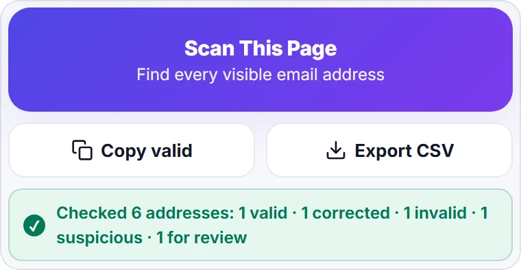
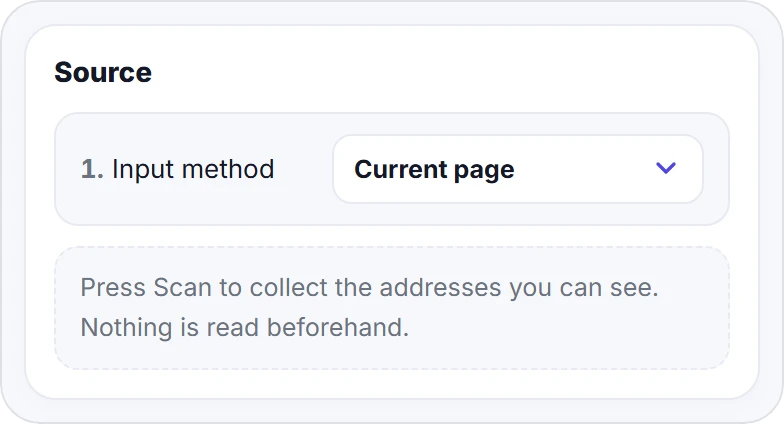
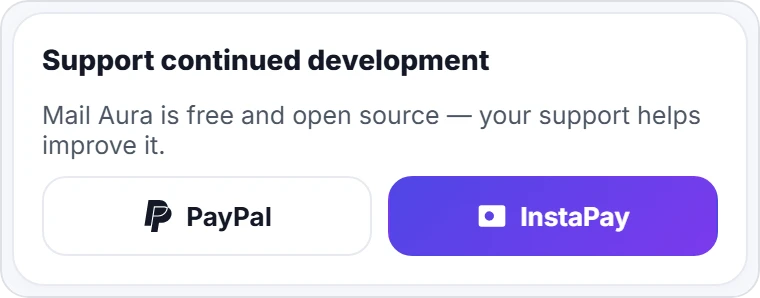

<p align="center">
  
</p>

<h1 align="center">Mail Aura — Verificador de correos y limpiador de listas</h1>

<p align="center">Verifica direcciones de correo electrónico con ocho fuentes públicas gratuitas, limpia listas largas con un clic y exporta los resultados como CSV — sin clave de API, sin cuenta y sin conjeturas. La interfaz está disponible en ocho idiomas, incluido el RTL completo en árabe.</p>

<p align="center">
  <a href="https://github.com/el9a7rawi/Mail-Aura/releases"></a>
  <a href="https://github.com/el9a7rawi/Mail-Aura/blob/main/LICENSE"></a>
  <a href="https://github.com/el9a7rawi/Mail-Aura/pulls"></a>
  <a href="https://developer.chrome.com/docs/extensions"></a>
  
  
</p>

<h4 align="center">
  <a href="README.md">English</a> · <a href="README.es.md"><b>Español</b></a> · <a href="README.fr.md">Français</a> · <a href="README.de.md">Deutsch</a> · <a href="README.pt-BR.md">Português (Brasil)</a> · <a href="README.ru.md">Русский</a> · <a href="README.ar.md">العربية</a> · <a href="README.zh-CN.md">中文（简体）</a>
</h4>
<h3 align="center">Download for your browser — click the icon</h3>

<div align="center">

| [<br><b>Chrome</b>](https://github.com/el9a7rawi/Mail-Aura/releases/latest) | [<br><b>Edge</b>](https://github.com/el9a7rawi/Mail-Aura/releases/latest) | [<br><b>Firefox</b>](https://github.com/el9a7rawi/Mail-Aura/releases/latest) | [<br><b>Brave</b>](https://github.com/el9a7rawi/Mail-Aura/releases/latest) | [<br><b>Opera</b>](https://github.com/el9a7rawi/Mail-Aura/releases/latest) |

Chrome y los navegadores Chromium son el objetivo principal. Firefox se admite desde la versión 140 mediante un archivo específico con su propio manifiesto (sidebar action y script de fondo clásico).
|---|---|---|---|---|

</div>

---

## 1. ¿Por qué Mail Aura?

<div align="center">

| Sin Mail Aura | Con Mail Aura |
|---|---|
| Adivinar solo por el formato | Ocho fuentes independientes más señales locales |
| Listas pegadas llenas de duplicados | Duplicados eliminados antes de la verificación |
| Limpieza manual de CSV | Importación y exportación de CSV con un clic |
| Una insignia del 100 % que no significa nada | Una puntuación honesta limitada al 88 % para direcciones válidas |

</div>

Ningún servicio público puede demostrar que un buzón específico existe sin enviar un correo real. Por eso, Mail Aura muestra una **puntuación de confianza**, no una garantía.

---

## 2. Cómo funciona — tres pasos

1. **Elige una fuente** — escanea la página actual, pega una lista o carga un CSV.
2. **Verifica** — las direcciones se comprueban en paralelo con ocho servicios gratuitos y se almacenan en caché por dominio.
3. **Actúa** — copia las direcciones válidas, corrige errores tipográficos con un clic o exporta todo como CSV.

---

## 3. Recorrido por la interfaz — cada parte de la extensión

### 3.1 Cabecera — todo al alcance
<p align="center"></p>

El título, el selector de idioma, el cambio de tema, el enlace a GitHub y el botón del panel lateral están en una sola fila compacta.

### 3.2 Una acción principal
<p align="center"></p>

Un único botón degradado realiza el trabajo para la fuente activa. Debajo, **Copiar válidos** y **Exportar CSV** están a un clic; la barra de resultados también ofrece **Copiar resultados visibles**, **Borrar resultados** y un botón de copia en cada fila. La línea de estado indica exactamente qué ocurrió.

### 3.3 Fuente — página actual
<p align="center"></p>

Escanea solo las direcciones visibles en la página que estás leyendo. No se lee nada hasta que pulsas el botón.

### 3.4 Fuente — lista pegada
<p align="center"></p>

Pega una dirección por línea o sepáralas con comas. Los duplicados desaparecen antes de la verificación; las líneas mal formadas se muestran como resultados.

### 3.5 Fuente — archivo CSV
<p align="center"></p>

Una tarjeta muestra el icono y el nombre del archivo seleccionado. Solo se lee la primera columna, así que funcionan incluso las exportaciones desordenadas.

### 3.6 Resultados — el corazón del producto
<p align="center"></p>

Cada fila muestra la dirección, una insignia de estado con color, una línea de motivo y acciones por fila. Los chips de fuentes opcionales muestran los identificadores de las fuentes que respondieron.

### 3.7 Filtro y búsqueda
<p align="center">
  
  
</p>

Siete estados de filtro y un campo de búsqueda expandible funcionan juntos; un retardo de 80 ms mantiene la escritura fluida.

### 3.8 Verificación desde el menú contextual

Selecciona una dirección o un enlace `mailto:` en cualquier página y elige **Verificar esta dirección de correo**. El resultado se abre en el popup y respeta el modo privacidad, por lo que no se realiza ninguna llamada externa cuando está activado.

### 3.9 Ajustes
<p align="center"></p>

El modo privacidad, el resaltado de la página, los chips de fuentes y la autocorrección opcional de CSV son interruptores explícitos. La autocorrección está desactivada por defecto y solo reescribe errores conocidos de dominio en CSV subidos; nunca adivina errores desconocidos. Activar el modo privacidad también vacía la caché de dominio en memoria.

### 3.10 Ocho idiomas, RTL real
<p align="center"></p>

Cambia al instante entre English, Español, Français, Deutsch, Português (Brasil), Русский, العربية y 中文（简体）. El árabe invierte todo el diseño de forma lógica, no cosmética.

### 3.11 Tema oscuro negro real

Un fondo realmente negro con contraste ajustado, activado desde la cabecera y recordado entre sesiones.

### 3.12 Panel lateral para listas largas
<p align="center"></p>

El mismo controlador, un lienzo más ancho y un único contenedor de desplazamiento: sin barras anidadas.

### 3.13 Estado vacío
<p align="center"></p>

Una invitación honesta a escanear o pegar, nunca una caja vacía.

### 3.14 Apoyar el desarrollo continuo
<p align="center"></p>

Mail Aura es gratuito y de código abierto. PayPal y una opción destacada de InstaPay ayudan a mejorarlo. Ambos se abren en una pestaña nueva; la extensión no envía datos.
## 4. Ocho fuentes gratuitas

1. Rapid Email Validator
2. Disify
3. DeBounce
4. MailCheck.ai
5. Disban
6. EmailProbe
7. Google DNS-over-HTTPS
8. Cloudflare DNS-over-HTTPS

Todas las llamadas usan HTTPS y no requieren clave. El modo privacidad las desactiva todas.

---

## 5. Instalación (sin empaquetar)

1. Abre `chrome://extensions`.
2. Activa el **modo de desarrollador**.
3. Haz clic en **Cargar sin empaquetar** y selecciona esta carpeta.
4. Haz clic en el icono de Mail Aura en la barra de herramientas.

No se requiere ningún paso de compilación ni dependencias externas.

---

## 6. Desarrollo

```powershell
node --test tests/
node --check ui.js             # comprobación de sintaxis de cada archivo JS
node scripts/check-ui.mjs      # IDs del DOM, archivos del manifiesto, CSP, HTTPS
node scripts/build-preview.mjs # regenera dev/preview.html y preview-side.html
```

Se requiere Chrome para el script de capturas:

```powershell
node scripts/screenshot.mjs --url "file:///C:/.../dev/preview.html?theme=light&tall=1" --out dev/preview-light.png
```

---

## 7. Privacidad

Consulta `privacy.html`. Las direcciones solo se envían cuando solicitas una comprobación, no se registra nada y todas las conexiones usan HTTPS. El resultado del menú contextual se conserva brevemente en storage.session. Las fuentes están incluidas localmente.

---

## 8. Licencia

El proyecto es de código abierto y gratuito para todos bajo la licencia **Apache-2.0** — úsalo, modifícalo y compártelo libremente; el texto completo está en [LICENSE](LICENSE).

---

<p align="center">Creado con cariño por <b>Ahmed Yousry</b> · <a href="https://github.com/el9a7rawi/Mail-Aura">Mail Aura</a> · <a href="LICENSE">Apache-2.0</a></p>
