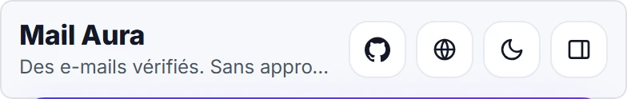
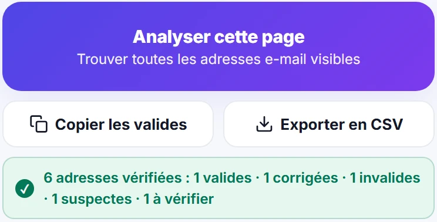
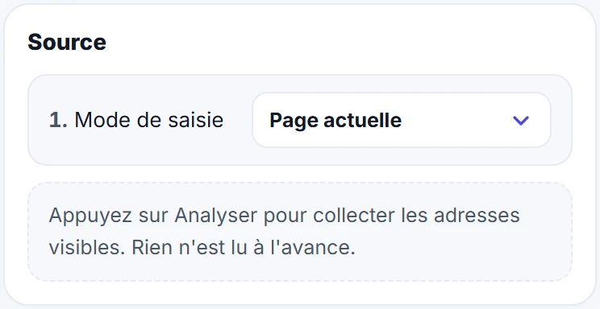
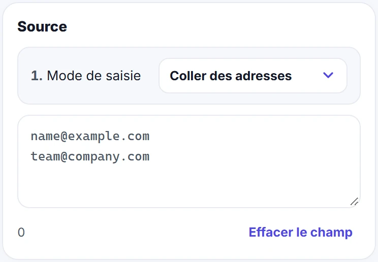
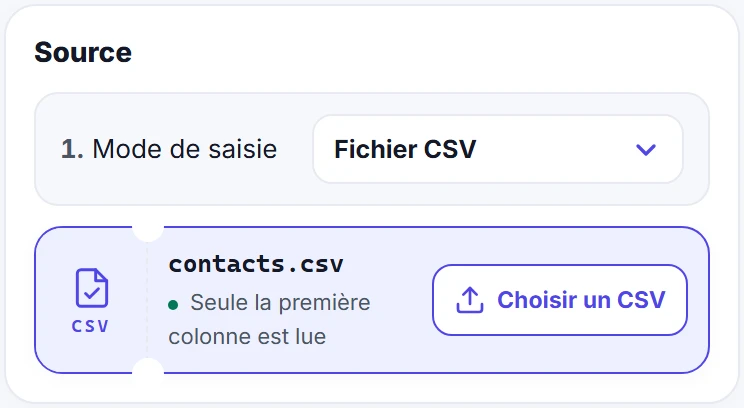
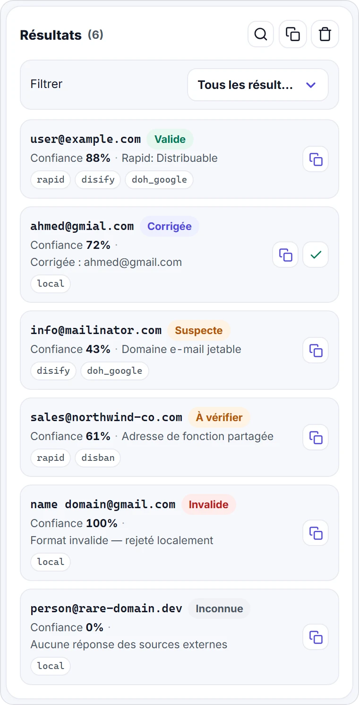
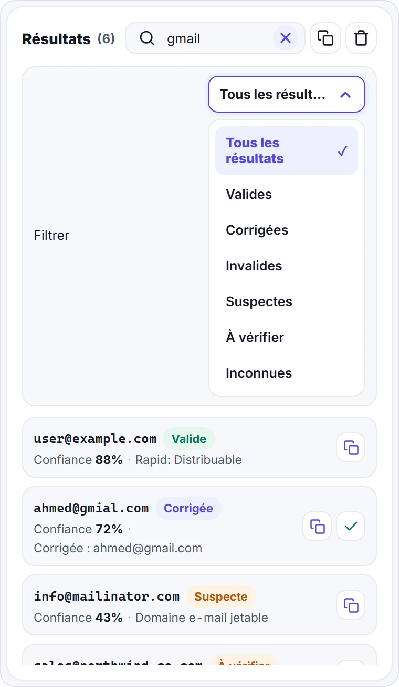
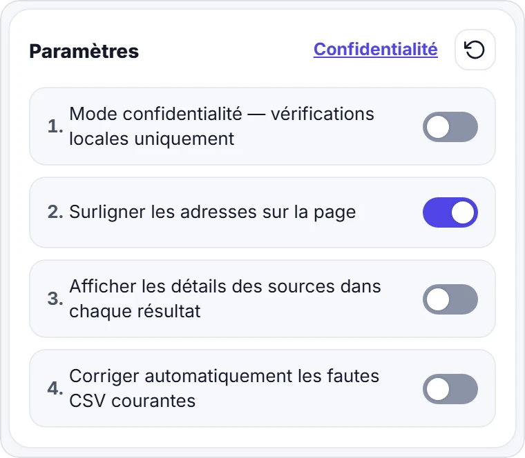
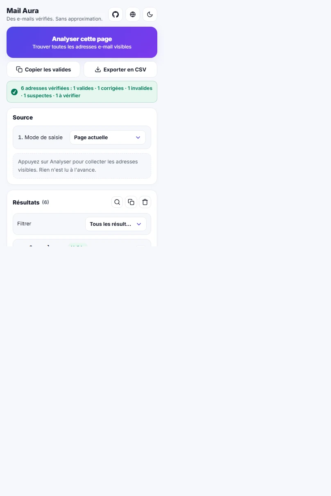

  

<h1 align="center">Mail Aura — Vérificateur d'e-mails et nettoyeur de listes</h1>

Vérifiez les adresses e-mail auprès de huit sources publiques gratuites, nettoyez les longues listes en un clic et exportez les résultats au format CSV — sans clé d'API, sans compte et sans approximation. L'interface est disponible en huit langues, dont l'arabe intégral en RTL.

  
  
  
  
  
  

<h4 align="center">
  <a href="README.md">English</a> · <a href="README.es.md">Español</a> · <a href="README.fr.md"><b>Français</b></a> · <a href="README.de.md">Deutsch</a> · <a href="README.pt-BR.md">Português (Brasil)</a> · <a href="README.ru.md">Русский</a> · <a href="README.ar.md">العربية</a> · <a href="README.zh-CN.md">中文（简体）</a>
</h4>
<h3 align="center">Download for your browser — click the icon</h3>

| [ <b>Chrome</b>](https://github.com/el9a7rawi/Mail-Aura/releases/latest) | [ <b>Edge</b>](https://github.com/el9a7rawi/Mail-Aura/releases/latest) | [ <b>Firefox</b>](https://github.com/el9a7rawi/Mail-Aura/releases/latest) | [ <b>Brave</b>](https://github.com/el9a7rawi/Mail-Aura/releases/latest) | [ <b>Opera</b>](https://github.com/el9a7rawi/Mail-Aura/releases/latest) |

Chrome et les navigateurs Chromium sont la cible principale. Firefox est pris en charge à partir de la version 140 via une archive dédiée avec son propre manifeste (action de barre latérale et script d’arrière-plan classique).
|---|---|---|---|---|

---

## 1. Pourquoi Mail Aura ?

| Sans Mail Aura | Avec Mail Aura |
|---|---|
| Deviner d'après le seul format | Huit sources indépendantes et des signaux locaux |
| Des listes collées pleines de doublons | Doublons supprimés avant la vérification |
| Nettoyage manuel du CSV | Import et export CSV en un clic |
| Un badge 100 % qui ne veut rien dire | Un score honnête plafonné à 88 % pour les adresses valides |

Aucun service public ne peut prouver qu'une boîte mail donnée existe sans envoyer un e-mail réel. Mail Aura affiche donc un **score de confiance**, et non une garantie.

---

## 2. Comment ça marche — trois étapes

1. **Choisissez une source** — analysez la page en cours, collez une liste ou chargez un fichier CSV.
2. **Vérifiez** — les adresses sont vérifiées en parallèle auprès de huit services gratuits et mises en cache par domaine.
3. **Agissez** — copiez les adresses valides, corrigez les fautes de frappe en un clic ou exportez tout au format CSV.

---

## 3. Visite de l'interface — toutes les parties de l'extension

### 3.1 En-tête — tout à portée de main

Le titre, le sélecteur de langue, le changement de thème, le lien GitHub et le bouton du panneau latéral sont sur une seule ligne compacte.

### 3.2 Une action principale

Un seul bouton dégradé effectue le travail pour la source active. En dessous, **Copier les valides** et **Exporter CSV** sont à un clic ; la barre d'outils propose aussi **Copier les résultats affichés**, **Effacer les résultats** et un bouton de copie sur chaque ligne. La ligne d'état indique exactement ce qui s'est passé.

### 3.3 Source — page actuelle

Analyse uniquement les adresses visibles sur la page que vous lisez. Rien n'est lu avant que vous n'appuyiez sur le bouton.

### 3.4 Source — liste collée

Collez une adresse par ligne ou séparez-les par des virgules. Les doublons disparaissent avant la vérification ; les lignes mal formées restent visibles comme résultats.

### 3.5 Source — fichier CSV

Une carte affiche l'icône et le nom du fichier sélectionné. Seule la première colonne est lue : même les exports désordonnés fonctionnent.

### 3.6 Résultats — le cœur du produit

Chaque ligne affiche l'adresse, un badge de statut coloré, une ligne de motif et des actions par ligne. Les pastilles de sources optionnelles montrent les identifiants des sources ayant répondu.

### 3.7 Filtre et recherche

Sept états de filtre et un champ de recherche déployable fonctionnent ensemble ; un délai de 80 ms garde la saisie fluide.

### 3.8 Vérification via le menu contextuel

Sélectionnez une adresse ou un lien `mailto:` sur n'importe quelle page, puis choisissez **Vérifier cette adresse e-mail**. Le résultat s'ouvre dans le popup et respecte le mode confidentialité : aucun appel externe n'est effectué lorsqu'il est activé.

### 3.9 Paramètres

Le mode confidentialité, la mise en évidence de la page, les pastilles de sources et la correction automatique optionnelle sont des interrupteurs explicites. La correction est désactivée par défaut et ne réécrit que les erreurs de domaine connues dans les listes collées, les analyses de page et les CSV — y compris en mode confidentialité. Aucune erreur inconnue ou ambiguë n'est devinée. Activer le mode confidentialité vide aussi le cache de domaine en mémoire.

### 3.10 Huit langues, vrai RTL

Basculez instantanément entre English, Español, Français, Deutsch, Português (Brasil), Русский, العربية et 中文（简体）. L'arabe inverse toute la mise en page de façon logique, et non cosmétique.

### 3.11 Thème sombre noir profond

Un vrai fond noir avec un contraste réglé, activé depuis l'en-tête et mémorisé entre les sessions.

### 3.12 Panneau latéral pour les longues listes

Le même contrôleur, un canevas plus large et un seul conteneur de défilement : pas de barres imbriquées.

### 3.13 État vide

Une invitation honnête à analyser ou coller, jamais une boîte vide.

### 3.14 Soutenir le développement continu

Mail Aura est gratuit et open source. PayPal et une option InstaPay mise en avant aident à l'améliorer. Les deux s'ouvrent dans un nouvel onglet ; l'extension n'envoie aucune donnée.
## 4. Huit sources gratuites

1. Rapid Email Validator
2. Disify
3. DeBounce
4. MailCheck.ai
5. Disban
6. EmailProbe
7. Google DNS-over-HTTPS
8. Cloudflare DNS-over-HTTPS

Tous les appels passent par HTTPS et ne nécessitent aucune clé. Le mode confidentialité les désactive tous.

---

## 5. Installation (non empaquetée)

1. Ouvrez `chrome://extensions`.
2. Activez le **mode développeur**.
3. Cliquez sur **Charger l'extension non empaquetée** et sélectionnez ce dossier.
4. Cliquez sur l'icône Mail Aura dans la barre d'outils.

Aucune étape de compilation ni dépendance externe n'est requise.

---

## 6. Développement

Le dépôt publié ne contient que l’extension et sa documentation. Les fixtures de développement, les scripts d’aide et la suite de tests locale sont volontairement exclus ; GitHub Actions valide le manifeste, le CSP, la couverture des langues et les fichiers embarqués à chaque push.

---

## 7. Confidentialité

Consultez `privacy.html`. Les adresses ne sont envoyées que sur demande, rien n’est suivi et toutes les connexions utilisent HTTPS. Le résultat du menu contextuel reste brièvement dans storage.session. Les polices sont embarquées localement.

---

## 8. Licence

Le projet est open source et gratuit pour tous sous licence **Apache-2.0** — utilisez-le, modifiez-le et partagez-le librement ; le texte intégral se trouve dans [LICENSE](LICENSE).

---

Réalisé avec soin par <b>Ahmed Yousry</b> · <a href="https://github.com/el9a7rawi/Mail-Aura">Mail Aura</a> · <a href="LICENSE">Apache-2.0</a>

