<p align="center">
  
</p>

<h1 align="center">Mail Aura — Email Verifier & List Cleaner</h1>

<p align="center">Verify email addresses with eight free public sources, clean long lists in one click, and export the results as CSV — no API keys, no account, no guesswork. Eight interface languages are bundled, including full Arabic RTL.</p>

<p align="center">
  <a href="https://github.com/el9a7rawi/Mail-Aura/releases"></a>
  <a href="https://github.com/el9a7rawi/Mail-Aura/blob/main/LICENSE"></a>
  <a href="https://github.com/el9a7rawi/Mail-Aura/pulls"></a>
  <a href="https://developer.chrome.com/docs/extensions"></a>
  
  
</p>

<p align="center">
  <sub><b>Languages:</b> <a href="README.md"><b>English</b></a> · <a href="README.es.md">Español</a> · <a href="README.fr.md">Français</a> · <a href="README.de.md">Deutsch</a> · <a href="README.pt-BR.md">Português (Brasil)</a> · <a href="README.ru.md">Русский</a> · <a href="README.ar.md">العربية</a> · <a href="README.zh-CN.md">中文（简体）</a></sub>
</p>

<h3 align="center">Download for your browser — click the icon</h3>

<div align="center">

| [<br><b>Chrome</b>](https://github.com/el9a7rawi/Mail-Aura/releases/latest) | [<br><b>Edge</b>](https://github.com/el9a7rawi/Mail-Aura/releases/latest) | [<br><b>Firefox</b>](https://github.com/el9a7rawi/Mail-Aura/releases/latest) | [<br><b>Brave</b>](https://github.com/el9a7rawi/Mail-Aura/releases/latest) | [<br><b>Opera</b>](https://github.com/el9a7rawi/Mail-Aura/releases/latest) |
|---|---|---|---|---|

</div>

<p align="center">
  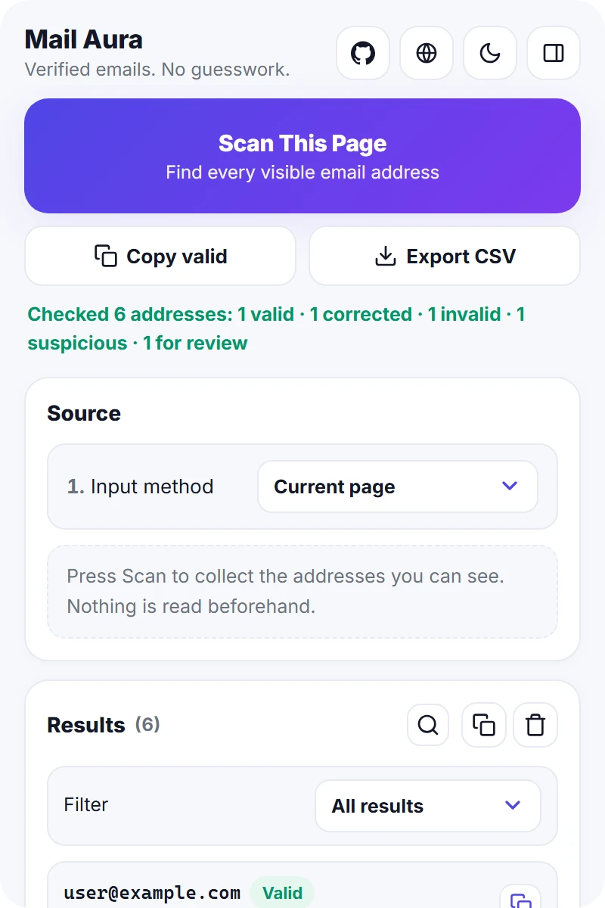
  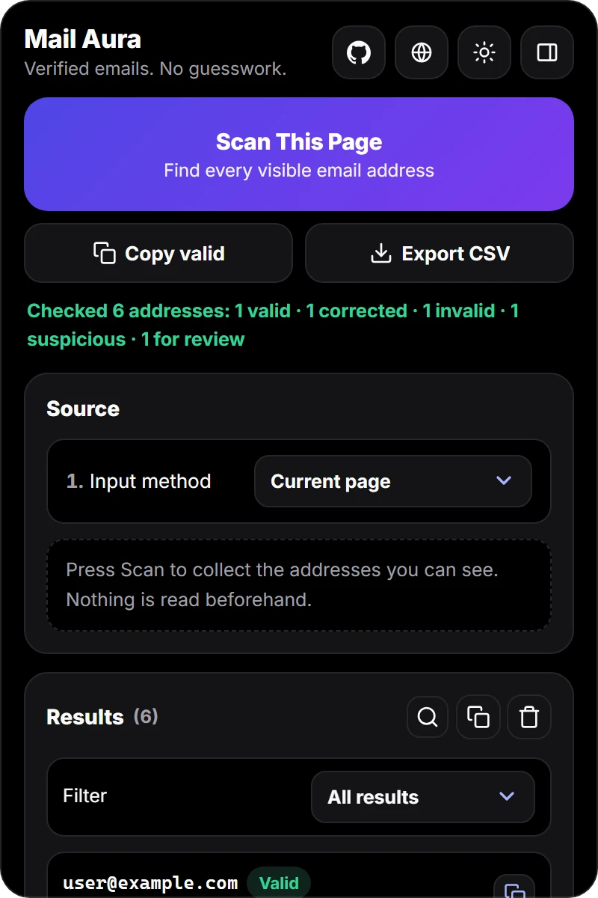
</p>

<p align="center">
  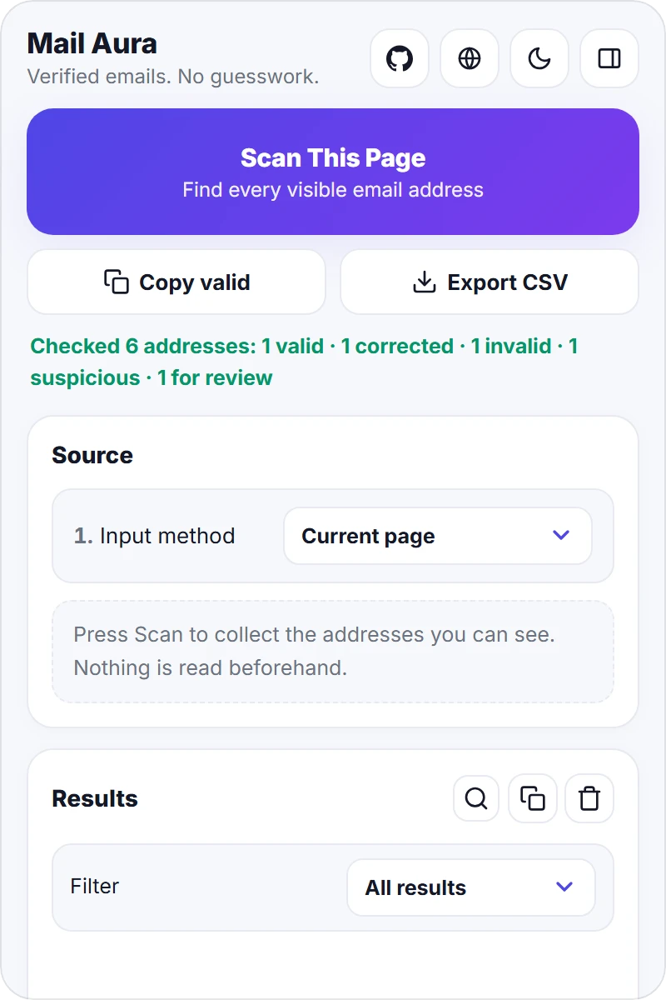
  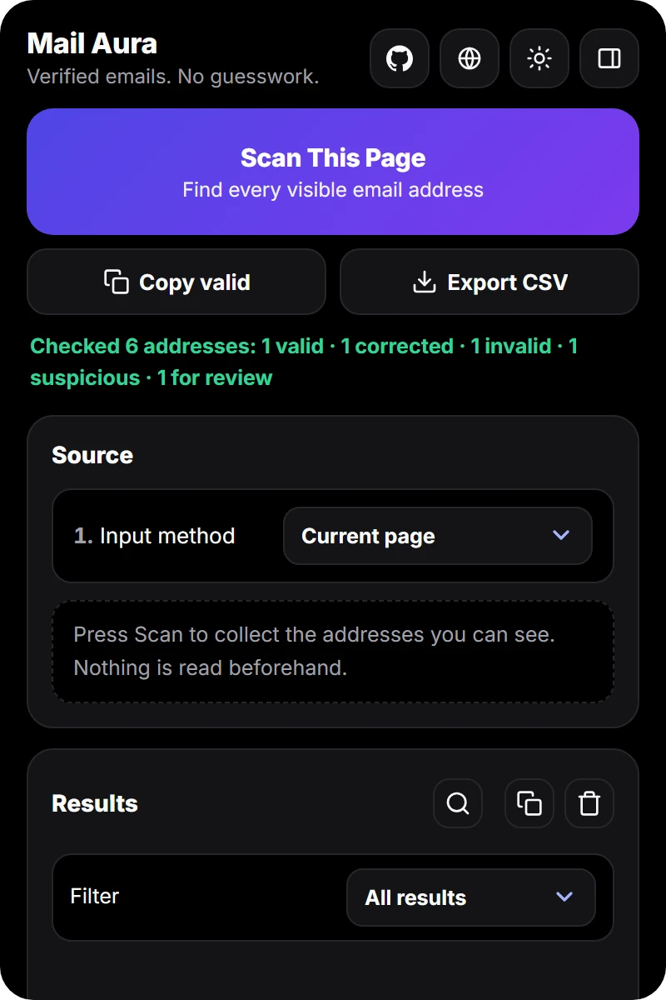
</p>

---

## 1. Why Mail Aura?

<div align="center">

| Without Mail Aura | With Mail Aura |
|---|---|
| Guess from format alone | Eight independent sources plus local signals |
| Pasted lists full of duplicates | Duplicates removed before verification |
| Manual CSV cleanup | One-click CSV import and export |
| A 100% badge that means nothing | An honest score capped at 88% for valid addresses |

</div>

No public service can prove that a specific mailbox exists without sending an actual email. Mail Aura therefore reports a **confidence score**, not a guarantee.

---

## 2. How it works — three steps

1. **Choose a source** — scan the current page, paste a list, or load a CSV.
2. **Verify** — addresses are checked in parallel against eight free services and cached by domain.
3. **Act** — copy the valid addresses, correct typos with one click, or export everything as CSV.

---

## 3. Interface tour — every part of the extension

### 3.1 Header — everything in reach
<p align="center">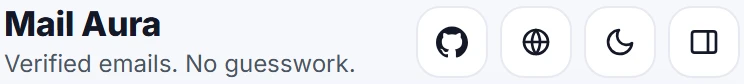</p>

The title, language picker, theme toggle, GitHub link, and side-panel button sit in one compact row. The filename says it is a product, not a science experiment.

### 3.2 One primary action
<p align="center">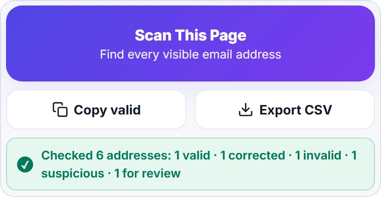</p>

A single gradient button does the work for the active source. Under it, **Copy valid** and **Export CSV** are one click away, and the status line tells you exactly what happened.

### 3.3 Source — current page
<p align="center">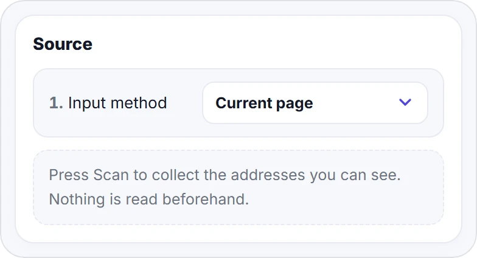</p>

Scan only the addresses visible on the page you are reading. Nothing is read until you press the button.

### 3.4 Source — pasted list
<p align="center">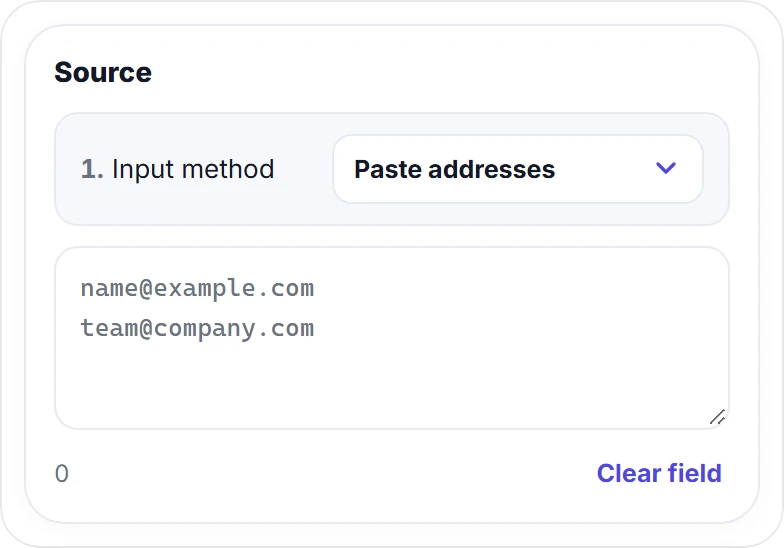</p>

Paste one address per line or separate with commas. Duplicates disappear before verification, malformed lines stay visible as results.

### 3.5 Source — CSV file
<p align="center">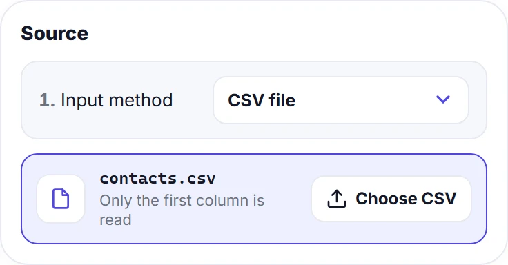</p>

A proper file card with icon and filename replaces a bare hyperlink. Only the first column is read, so messy exports still work.

### 3.6 Results — the core of the product
<p align="center">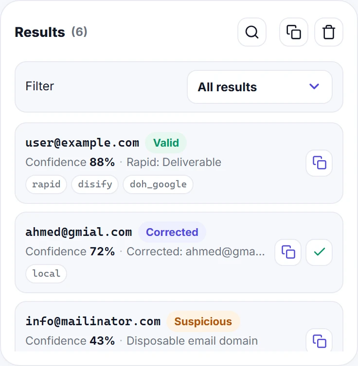</p>

Each row shows the address, a colour-coded status badge, one reason line, and per-row actions. Optional source chips expose exactly which services answered.

### 3.7 Filter and search
<p align="center">
  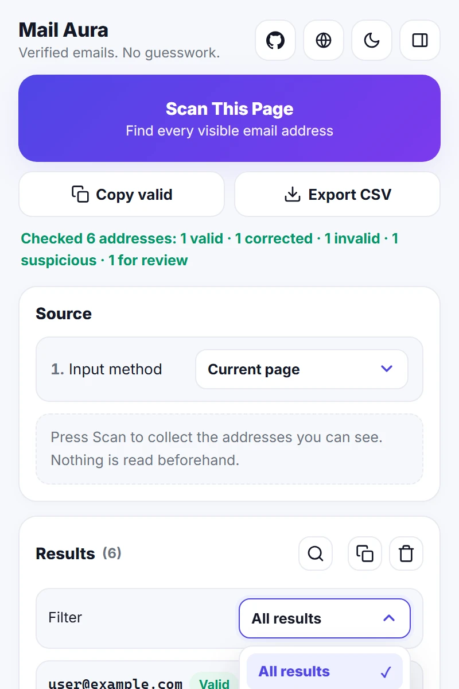
  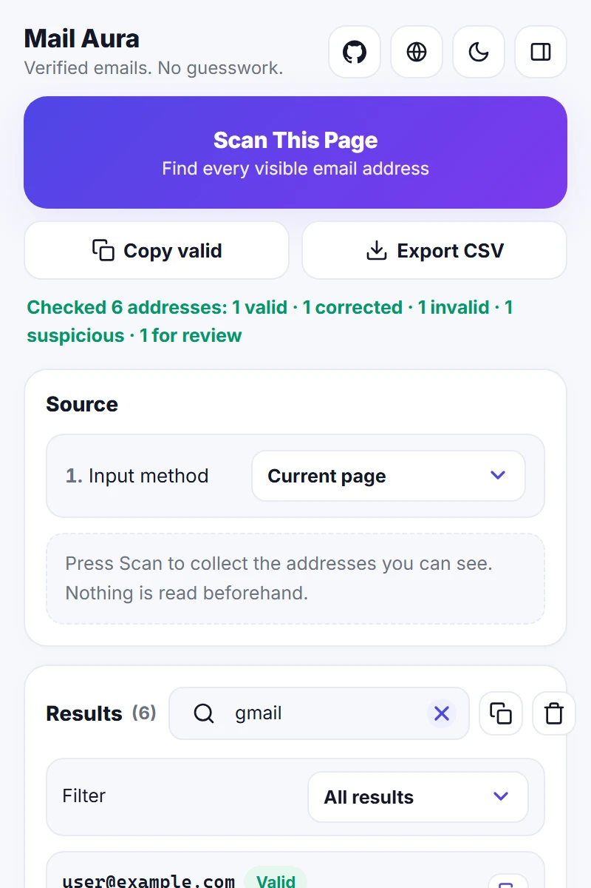
</p>

Seven filter states and an expanding search field turn a long list into the three rows you care about.

### 3.8 Options
<p align="center">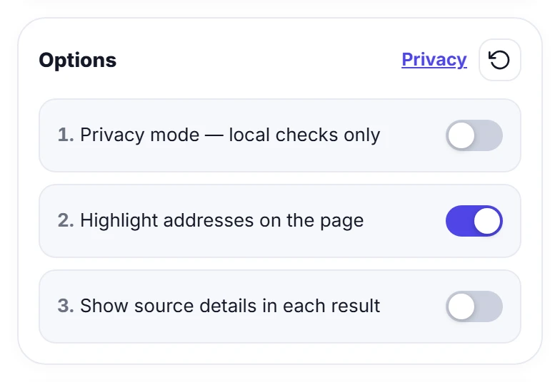</p>

Privacy mode, page highlighting, and source chips are explicit switches. Nothing hidden, nothing surprising.

### 3.9 Eight languages, real RTL
<p align="center"></p>

Switch instantly between English, Español, Français, Deutsch, Português (Brasil), Русский, العربية, and 中文（简体）. Arabic flips the whole layout logically, not cosmetically.

### 3.10 Side panel for long lists
<p align="center">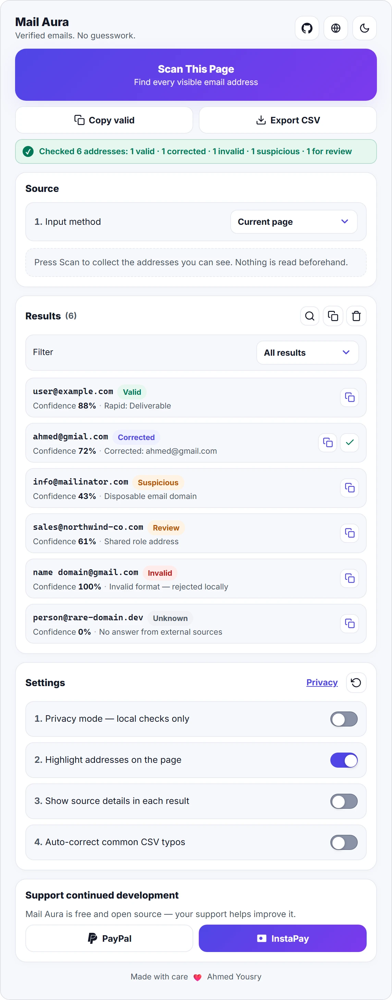</p>

The same controller, a wider canvas, and one scroll container — no nested scrollbars.

### 3.11 Empty state
<p align="center">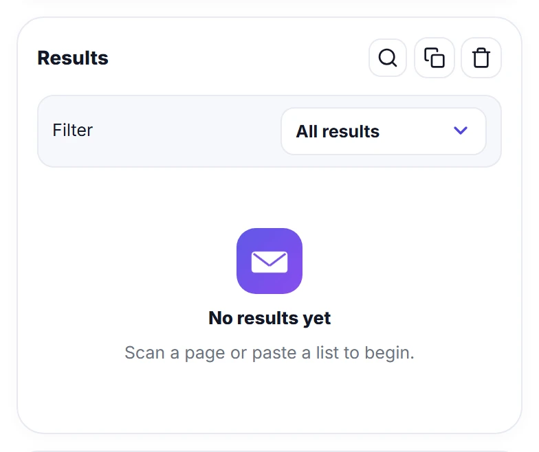</p>

An honest invite to scan or paste, never a blank box.

### 3.12 Support continued development
<p align="center">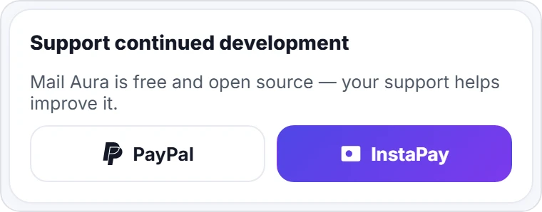</p>

Mail Aura is free and open source. An optional InstaPay button and PayPal alternative help keep it improving. Both open in a new tab; the extension sends no data.

---

## 4. Eight free sources

1. Rapid Email Validator
2. Disify
3. DeBounce
4. MailCheck.ai
5. Disban
6. EmailProbe
7. Google DNS-over-HTTPS
8. Cloudflare DNS-over-HTTPS

All calls are HTTPS and keyless. Privacy mode disables them all.

---

## 5. Install (unpacked)

1. Open `chrome://extensions`.
2. Enable **Developer mode**.
3. Click **Load unpacked** and select this folder.
4. Click the Mail Aura icon in the toolbar.

No build step and no external dependencies are required.

---

## 6. Development

```powershell
node --test tests/             # 49 unit tests
node --check ui.js             # syntax check for every JS file
node scripts/check-ui.mjs      # DOM ids, manifest files, CSP, HTTPS, locale keys
node scripts/build-preview.mjs # regenerate dev fixtures from the real markup
```

Chrome is required for the screenshot helper:

```powershell
node scripts/screenshot.mjs --url "file:///C:/.../dev/preview.html?theme=light" --out dev/preview-light.png --format webp --round --viewport
```

---

## 7. Privacy

See `privacy.html`. Addresses are sent only when you request a check, nothing is tracked, and all connections use HTTPS. The only declared exception is a single Google Fonts stylesheet loaded when the interface opens; no email or verification data is sent with it.

---

## 8. License

The project is open source and free for everyone under the **Apache-2.0** license — use it, modify it, and share it freely; the full text is in [LICENSE](LICENSE).

---

<p align="center">Built with care by <b>Ahmed Yousry</b> · <a href="https://github.com/el9a7rawi/Mail-Aura">Mail Aura</a> · <a href="LICENSE">Apache-2.0</a></p>
