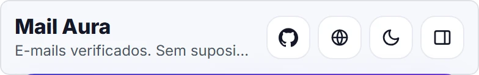
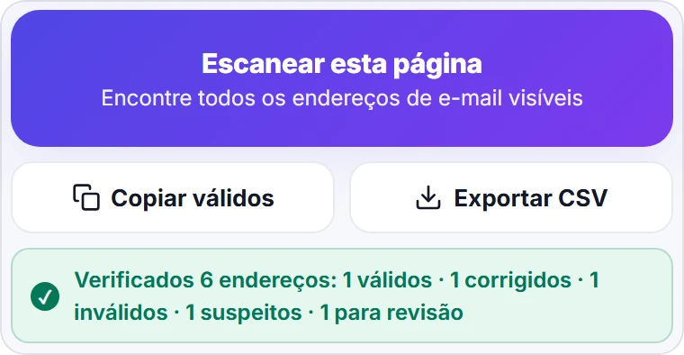
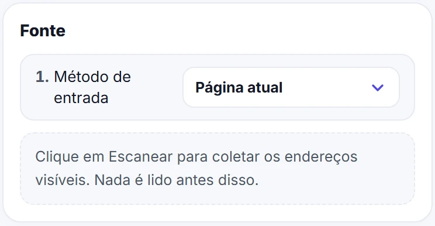
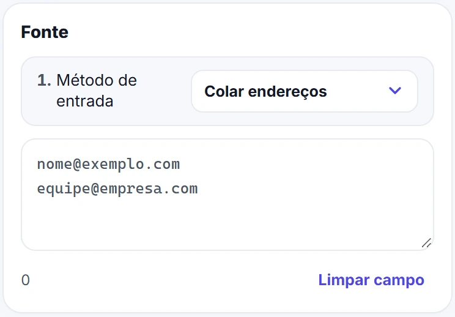
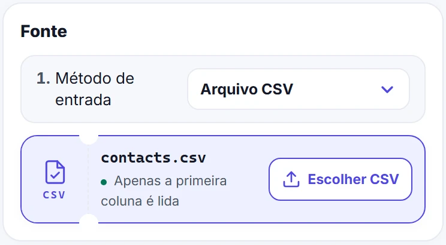
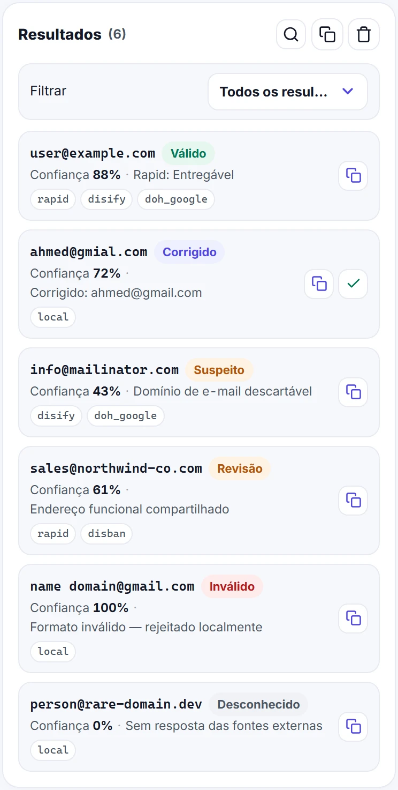
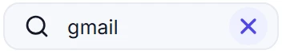
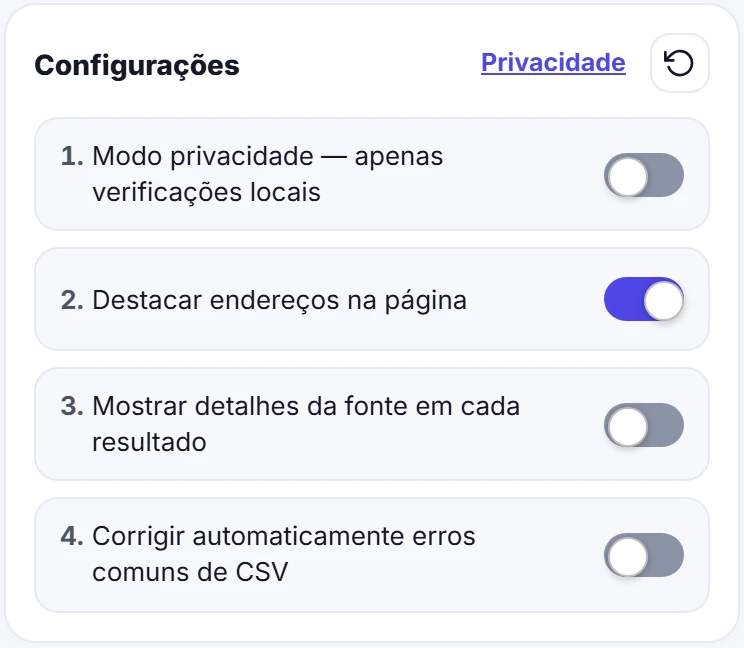
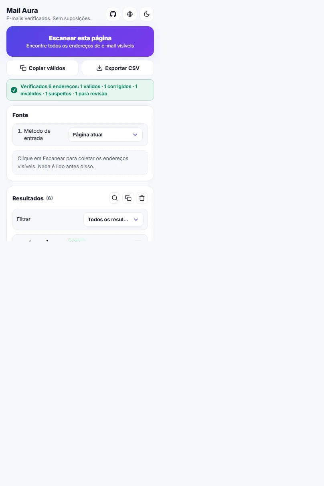
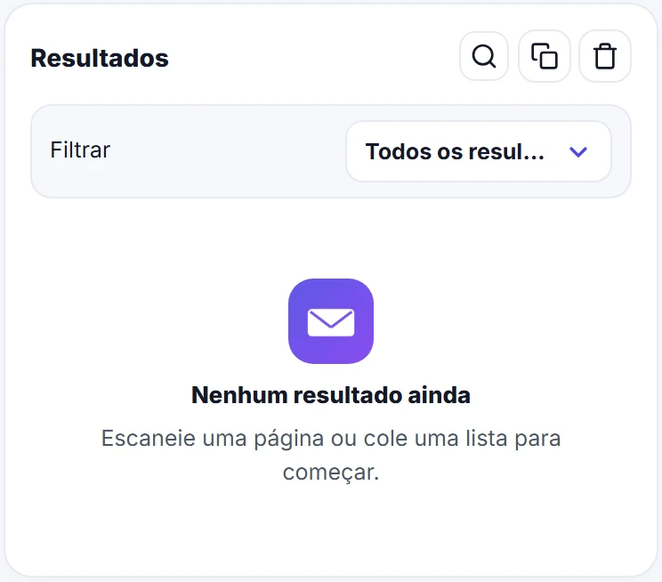

  

<h1 align="center">Mail Aura — Verificador de E-mails e Limpador de Listas</h1>

Verifique endereços de e-mail usando oito fontes públicas gratuitas, limpe listas longas com um clique e exporte os resultados em CSV — sem chave de API, sem conta e sem adivinhação. A interface vem em oito idiomas, incluindo suporte completo a RTL em árabe.

  
  
  
  
  
  

<h4 align="center">
  <a href="README.md">English</a> · <a href="README.es.md">Español</a> · <a href="README.fr.md">Français</a> · <a href="README.de.md">Deutsch</a> · <a href="README.pt-BR.md"><b>Português (Brasil)</b></a> · <a href="README.ru.md">Русский</a> · <a href="README.ar.md">العربية</a> · <a href="README.zh-CN.md">中文（简体）</a>
</h4>
<h3 align="center">Download for your browser — click the icon</h3>

| [ <b>Chrome</b>](https://github.com/el9a7rawi/Mail-Aura/releases/latest) | [ <b>Edge</b>](https://github.com/el9a7rawi/Mail-Aura/releases/latest) | [ <b>Firefox</b>](https://github.com/el9a7rawi/Mail-Aura/releases/latest) | [ <b>Brave</b>](https://github.com/el9a7rawi/Mail-Aura/releases/latest) | [ <b>Opera</b>](https://github.com/el9a7rawi/Mail-Aura/releases/latest) |

Chrome e navegadores Chromium são o foco principal. Firefox é compatível a partir da versão 140 por meio de um arquivo dedicado com seu próprio manifesto (ação da barra lateral e script de segundo plano clássico).
|---|---|---|---|---|

---

## 1. Por que usar o Mail Aura?

| Sem o Mail Aura | Com o Mail Aura |
|---|---|
| Adivinhar apenas pelo formato | Oito fontes independentes mais sinais locais |
| Listas coladas cheias de duplicatas | Duplicatas removidas antes da verificação |
| Limpeza manual de CSV | Importação e exportação de CSV com um clique |
| Um selo de 100% que não significa nada | Uma pontuação honesta, limitada a 88% para endereços válidos |

Nenhum serviço público consegue provar que uma caixa de correio específica existe sem enviar um e-mail real. Por isso, o Mail Aura informa uma **pontuação de confiança**, e não uma garantia.

---

## 2. Como funciona — três etapas

1. **Escolha uma fonte** — examine a página atual, cole uma lista ou carregue um CSV.
2. **Verifique** — os endereços são checados em paralelo em oito serviços gratuitos e armazenados em cache por domínio.
3. **Aja** — copie os endereços válidos, corrija erros de digitação com um clique ou exporte tudo em CSV.

---

## 3. Visão geral da interface — todas as partes da extensão

### 3.1 Cabeçalho — tudo ao alcance

O título, o seletor de idioma, o alternador de tema, o link do GitHub e o botão do painel lateral ficam em uma única linha compacta.

### 3.2 Uma ação principal

Um único botão gradiente faz o trabalho da fonte ativa. Abaixo, **Copiar válidos** e **Exportar CSV** estão a um clique; a barra de resultados também oferece **Copiar resultados exibidos**, **Limpar resultados** e um botão de copiar em cada linha. A linha de status diz exatamente o que aconteceu.

### 3.3 Fonte — página atual

Escaneie apenas os endereços visíveis na página que você está lendo. Nada é lido até você pressionar o botão.

### 3.4 Fonte — lista colada

Cole um endereço por linha ou separe-os com vírgulas. Duplicatas desaparecem antes da verificação; linhas malformadas permanecem visíveis como resultados.

### 3.5 Fonte — arquivo CSV

Um cartão mostra o ícone e o nome do arquivo selecionado. Apenas a primeira coluna é lida, então exportações bagunçadas ainda funcionam.

### 3.6 Resultados — o núcleo do produto

Cada linha mostra o endereço, um selo de status com cor, uma linha de motivo e ações por linha. Chips de fontes opcionais mostram os identificadores das fontes que realmente responderam.

### 3.7 Filtro e busca

  
  

Sete estados de filtro e um campo de busca expansível trabalham juntos; um atraso de 80 ms mantém a digitação suave.

### 3.8 Verificação pelo menu de contexto

Selecione um endereço ou um link `mailto:` em qualquer página e escolha **Verificar este endereço de e-mail**. O resultado abre no popup e respeita o modo privacidade, portanto nenhuma chamada externa ocorre quando ele está ativado.

### 3.9 Configurações

O modo privacidade, o destaque na página, os chips de fontes e a autocorreção opcional de CSV são interruptores explícitos. A autocorreção vem desligada e só reescreve erros conhecidos de domínio em CSVs enviados; erros desconhecidos nunca são adivinhados. Ativar o modo privacidade também limpa o cache de domínio em memória.

### 3.10 Oito idiomas, RTL real

Alterne instantaneamente entre English, Español, Français, Deutsch, Português (Brasil), Русский, العربية e 中文（简体）. O árabe inverte todo o layout de forma lógica, não apenas cosmética.

### 3.11 Tema escuro preto real

Um fundo realmente preto com contraste ajustado, ativado no cabeçalho e lembrado entre sessões.

### 3.12 Painel lateral para listas longas

O mesmo controlador, uma área mais ampla e um único contêiner de rolagem — sem barras aninhadas.

### 3.13 Estado vazio

Um convite honesto para escanear ou colar, nunca uma caixa vazia.

### 3.14 Apoiar o desenvolvimento contínuo

O Mail Aura é gratuito e de código aberto. PayPal e uma opção InstaPay em destaque ajudam a melhorá-lo. Ambos abrem em uma nova aba; a extensão não envia dados.
## 4. Oito fontes gratuitas

1. Rapid Email Validator
2. Disify
3. DeBounce
4. MailCheck.ai
5. Disban
6. EmailProbe
7. Google DNS-over-HTTPS
8. Cloudflare DNS-over-HTTPS

Todas as chamadas usam HTTPS e não exigem chave. O modo privacidade desativa todas elas.

---

## 5. Instalação (sem empacotamento)

1. Abra `chrome://extensions`.
2. Ative o **Modo do desenvolvedor**.
3. Clique em **Carregar sem compactação** e selecione esta pasta.
4. Clique no ícone do Mail Aura na barra de ferramentas.

Não é necessária nenhuma etapa de compilação nem dependências externas.

---

## 6. Desenvolvimento

O repositório publicado contém apenas a extensão e sua documentação. Arquivos de desenvolvimento, scripts auxiliares e a suíte de testes local ficam de fora intencionalmente; o GitHub Actions valida o manifesto, o CSP, a cobertura de idiomas e os arquivos incluídos a cada push.

---

## 7. Privacidade

Consulte `privacy.html`. Os endereços são enviados apenas quando você solicita, nada é rastreado e todas as conexões usam HTTPS. O resultado do menu de contexto fica brevemente em storage.session. As fontes são incluídas localmente.

---

## 8. Licença

O projeto é de código aberto e gratuito para todos sob a licença **Apache-2.0** — use-o, modifique-o e compartilhe-o livremente; o texto completo está em [LICENSE](LICENSE).

---

Feito com carinho por <b>Ahmed Yousry</b> · <a href="https://github.com/el9a7rawi/Mail-Aura">Mail Aura</a> · <a href="LICENSE">Apache-2.0</a>

