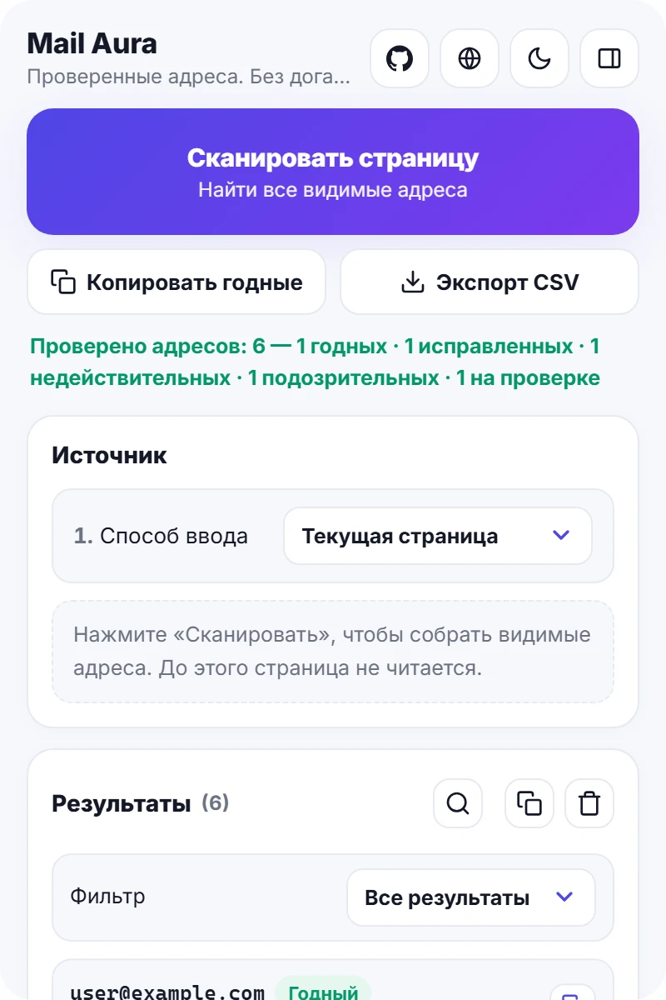

<p align="center">
  
</p>

<h1 align="center">Mail Aura — Проверка email и очистка списков</h1>

<p align="center">Проверяйте адреса электронной почты по восьми бесплатным публичным источникам, очищайте длинные списки в один клик и экспортируйте результаты в CSV — без API-ключа, аккаунта и гадания. Интерфейс доступен на восьми языках, включая полную поддержку RTL для арабского.</p>

<p align="center">
  <a href="https://github.com/el9a7rawi/Mail-Aura/releases"></a>
  <a href="https://github.com/el9a7rawi/Mail-Aura/blob/main/LICENSE"></a>
  <a href="https://github.com/el9a7rawi/Mail-Aura/pulls"></a>
  <a href="https://developer.chrome.com/docs/extensions"></a>
  
  
</p>

<p align="center">
  <sub><b>Языки:</b> <a href="README.md">English</a> · <a href="README.es.md">Español</a> · <a href="README.fr.md">Français</a> · <a href="README.de.md">Deutsch</a> · <a href="README.pt-BR.md">Português (Brasil)</a> · <a href="README.ru.md"><b>Русский</b></a> · <a href="README.ar.md">العربية</a> · <a href="README.zh-CN.md">中文（简体）</a></sub>
</p>
<h3 align="center">Download for your browser — click the icon</h3>

<div align="center">

| [<br><b>Chrome</b>](https://github.com/el9a7rawi/Mail-Aura/releases/latest) | [<br><b>Edge</b>](https://github.com/el9a7rawi/Mail-Aura/releases/latest) | [<br><b>Firefox</b>](https://github.com/el9a7rawi/Mail-Aura/releases/latest) | [<br><b>Brave</b>](https://github.com/el9a7rawi/Mail-Aura/releases/latest) | [<br><b>Opera</b>](https://github.com/el9a7rawi/Mail-Aura/releases/latest) |
|---|---|---|---|---|

</div>


<p align="center">
  
</p>

---

## 1. Зачем Mail Aura?

<div align="center">

| Без Mail Aura | С Mail Aura |
|---|---|
| Догадки только по формату | Восемь независимых источников плюс локальные признаки |
| Вставленные списки с дубликатами | Дубликаты удаляются до проверки |
| Ручная очистка CSV | Импорт и экспорт CSV в один клик |
| Значок 100%, который ничего не значит | Честная оценка, ограниченная 88% для корректных адресов |

</div>

Ни один публичный сервис не может доказать существование конкретного почтового ящика, не отправив реальное письмо. Поэтому Mail Aura показывает **оценку достоверности**, а не гарантию.

---

## 2. Как это работает — три шага

1. **Выберите источник** — проверьте текущую страницу, вставьте список или загрузите CSV.
2. **Проверьте** — адреса проверяются параллельно по восьми бесплатным сервисам и кэшируются по домену.
3. **Действуйте** — скопируйте корректные адреса, исправьте опечатки в один клик или экспортируйте всё в CSV.

---

## 3. Обзор интерфейса

### 3.1 Одно основное действие, три режима ввода
- **Сканировать эту страницу** — собирает видимые адреса и подсвечивает их, не считывая страницу заранее.
- **Вставить адреса** — по одному в строке или через запятую; дубликаты удаляются, а некорректный синтаксис отображается как результат.
- **CSV-файл** — читает первый столбец и экспортирует новый CSV со статусом, оценкой достоверности, совпадением источников, предложением и подробностями по источникам.

### 3.2 Результаты, которым можно доверять
- Каждая строка показывает адрес, значок статуса и одну короткую строку: `Достоверность N% · причина`.
- Фильтруйте по статусу, ищите среди результатов и копируйте корректные или видимые строки.
- Исправляйте известные опечатки доменов, например `gmial.com → gmail.com`, одним кликом.
- Одноразовые домены, служебные адреса и бесплатные почтовые сервисы помечаются, а не скрываются.

### 3.3 Режим конфиденциальности
- Мгновенно прекращает все внешние запросы; проверка становится только локальной.
- Индикатор подключения в нижней части всегда показывает текущее состояние.

### 3.4 Восемь языков и настоящий RTL
- По умолчанию английский; при первом запуске используется язык браузера, если он один из восьми.
- Переключение мгновенное и не требует перезагрузки.
- Арабский использует полную RTL-вёрстку с корректными правилами образования множественного числа.

### 3.5 Тёмная тема с настоящим чёрным
- Реальный чёрный фон с подобранным контрастом; переключается в шапке и запоминается.

### 3.6 Support continued development

- Mail Aura бесплатен и открыт. Необязательная кнопка InstaPay и PayPal как альтернатива помогают улучшать его. Обе ссылки открываются в новой вкладке, расширение не отправляет данные.

---

## 4. Восемь бесплатных источников

1. Rapid Email Validator
2. Disify
3. DeBounce
4. MailCheck.ai
5. Disban
6. EmailProbe
7. Google DNS-over-HTTPS
8. Cloudflare DNS-over-HTTPS

Все запросы идут по HTTPS без ключа. Режим конфиденциальности отключает их все.

---

## 5. Установка (без сборки)

1. Откройте `chrome://extensions`.
2. Включите **Режим разработчика**.
3. Нажмите **Загрузить распакованное расширение** и выберите эту папку.
4. Нажмите на иконку Mail Aura на панели инструментов.

Ни сборка, ни внешние зависимости не требуются.

---

## 6. Разработка

```powershell
node --test tests/             # 49 модульных тестов
node --check ui.js             # проверка синтаксиса каждого JS-файла
node scripts/check-ui.mjs      # ID в DOM, файлы манифеста, CSP, HTTPS
node scripts/build-preview.mjs # пересоздать dev/preview.html и preview-side.html
```

Для помощника со скриншотами нужен Chrome:

```powershell
node scripts/screenshot.mjs --url "file:///C:/.../dev/preview.html?theme=light&tall=1" --out dev/preview-light.png
```

---

## 7. Конфиденциальность

См. `privacy.html`. Адреса отправляются только когда вы запросили проверку, никакие данные не отслеживаются, а все соединения используют HTTPS. Единственное объявленное исключение — один стиль Google Fonts, загружаемый при открытии интерфейса; вместе с ним не отправляется никаких данных о письмах или проверках.

---

## 8. Лицензия

Проект с открытым исходным кодом и свободен для всех по лицензии **Apache-2.0** — используйте, изменяйте и распространяйте его свободно; полный текст находится в [LICENSE](LICENSE).

---

<p align="center">Сделано с заботой <b>Ahmed Yousry</b> · <a href="https://github.com/el9a7rawi/Mail-Aura">Mail Aura</a> · <a href="LICENSE">Apache-2.0</a></p>
