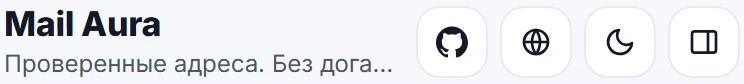
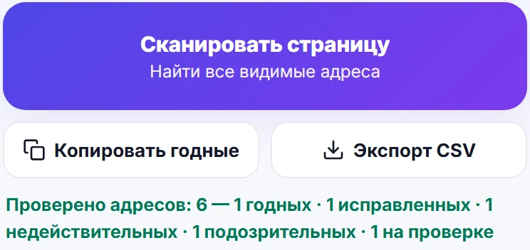
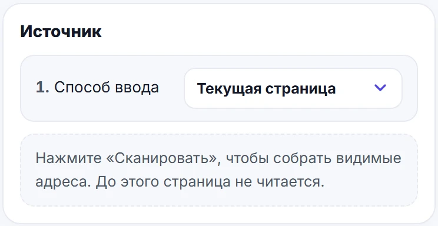
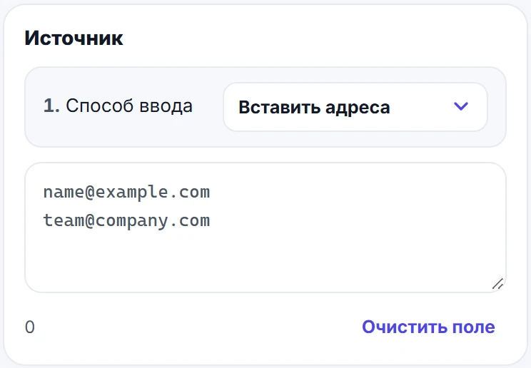
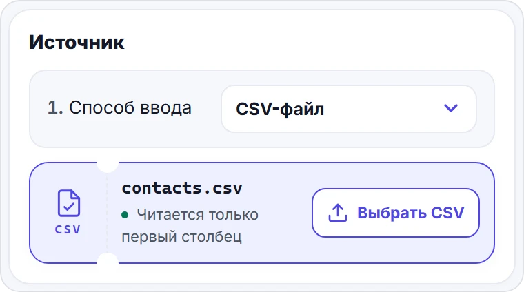
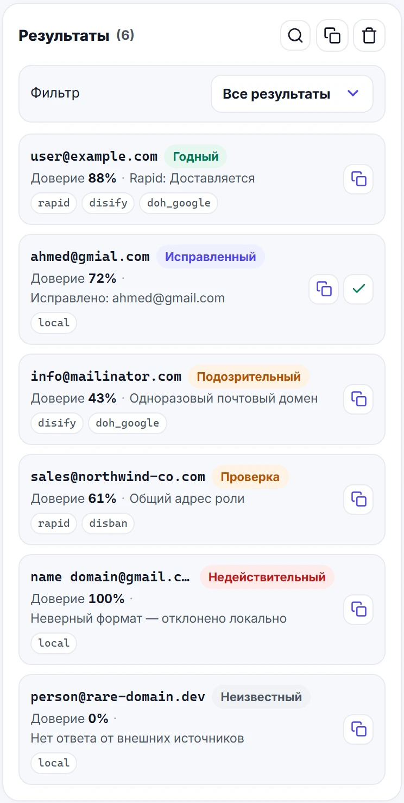
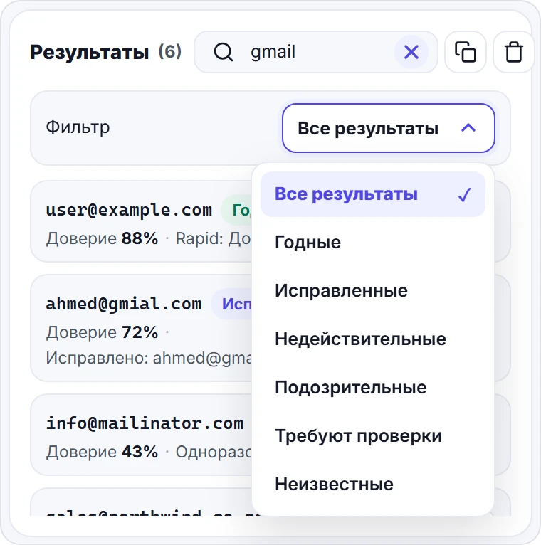
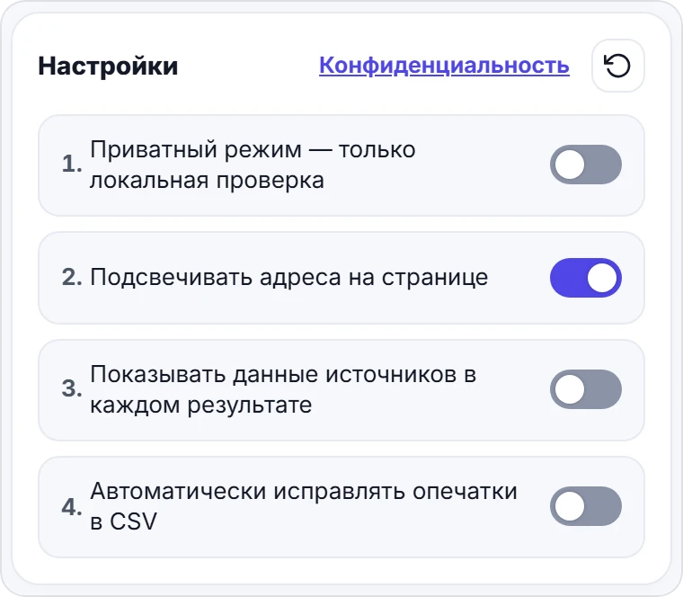
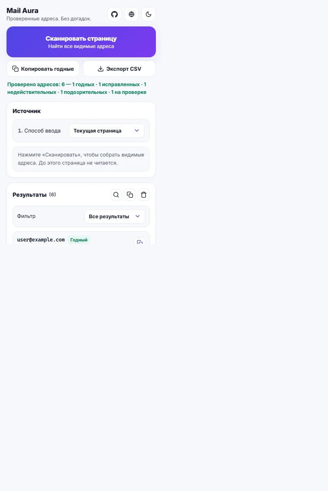
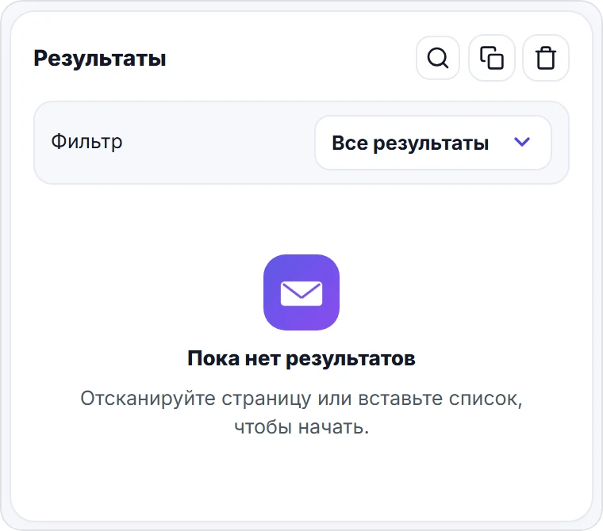

  

<h1 align="center">Mail Aura — Проверка email и очистка списков</h1>

Проверяйте адреса электронной почты по восьми бесплатным публичным источникам, очищайте длинные списки в один клик и экспортируйте результаты в CSV — без API-ключа, аккаунта и гадания. Интерфейс доступен на восьми языках, включая полную поддержку RTL для арабского.

  
  
  
  
  
  

<h4 align="center">
  <a href="README.md">English</a> · <a href="README.es.md">Español</a> · <a href="README.fr.md">Français</a> · <a href="README.de.md">Deutsch</a> · <a href="README.pt-BR.md">Português (Brasil)</a> · <a href="README.ru.md"><b>Русский</b></a> · <a href="README.ar.md">العربية</a> · <a href="README.zh-CN.md">中文（简体）</a>
</h4>
<h3 align="center">Download for your browser — click the icon</h3>

| [ <b>Chrome</b>](https://github.com/el9a7rawi/Mail-Aura/releases/latest) | [ <b>Edge</b>](https://github.com/el9a7rawi/Mail-Aura/releases/latest) | [ <b>Firefox</b>](https://github.com/el9a7rawi/Mail-Aura/releases/latest) | [ <b>Brave</b>](https://github.com/el9a7rawi/Mail-Aura/releases/latest) | [ <b>Opera</b>](https://github.com/el9a7rawi/Mail-Aura/releases/latest) |

Основная цель — Chrome и браузеры на Chromium. Firefox поддерживается начиная с версии 140 через отдельный архив со своим манифестом (действие боковой панели и классический фоновый сценарий).
|---|---|---|---|---|

---

## 1. Зачем Mail Aura?

| Без Mail Aura | С Mail Aura |
|---|---|
| Догадки только по формату | Восемь независимых источников плюс локальные признаки |
| Вставленные списки с дубликатами | Дубликаты удаляются до проверки |
| Ручная очистка CSV | Импорт и экспорт CSV в один клик |
| Значок 100%, который ничего не значит | Честная оценка, ограниченная 88% для корректных адресов |

Ни один публичный сервис не может доказать существование конкретного почтового ящика, не отправив реальное письмо. Поэтому Mail Aura показывает **оценку достоверности**, а не гарантию.

---

## 2. Как это работает — три шага

1. **Выберите источник** — проверьте текущую страницу, вставьте список или загрузите CSV.
2. **Проверьте** — адреса проверяются параллельно по восьми бесплатным сервисам и кэшируются по домену.
3. **Действуйте** — скопируйте корректные адреса, исправьте опечатки в один клик или экспортируйте всё в CSV.

---

## 3. Обзор интерфейса — все части расширения

### 3.1 Заголовок — всё под рукой

Заголовок, выбор языка, переключатель темы, ссылка на GitHub и кнопка боковой панели находятся в одном компактном ряду.

### 3.2 Одно основное действие

Одна кнопка с градиентом выполняет работу для активного источника. Под ней доступны **Копировать корректные** и **Экспорт CSV**; панель результатов также предлагает **Копировать показанные**, **Очистить результаты** и кнопку копирования в каждой строке. Строка состояния точно сообщает, что произошло.

### 3.3 Источник — текущая страница

Сканируются только адреса, видимые на текущей странице. Ничто не читается, пока вы не нажмёте кнопку.

### 3.4 Источник — вставленный список

Вставьте по одному адресу в строке или через запятую. Дубликаты удаляются до проверки; некорректные строки остаются видимыми как результаты.

### 3.5 Источник — CSV-файл

Карточка файла показывает значок и имя выбранного файла. Читается только первый столбец, поэтому даже беспорядочные экспорты работают.

### 3.6 Результаты — основа продукта

Каждая строка показывает адрес, цветной значок состояния, строку причины и действия для строки. Дополнительные метки источников показывают идентификаторы ответивших служб.

### 3.7 Фильтр и поиск

Семь состояний фильтра и раскрывающееся поле поиска работают вместе; задержка 80 мс сохраняет плавность ввода.

### 3.8 Проверка через контекстное меню

Выделите адрес или ссылку `mailto:` на любой странице и выберите **Проверить этот адрес электронной почты**. Результат открывается во всплывающем окне и соблюдает режим конфиденциальности: при включённом режиме внешние запросы не выполняются.

### 3.9 Настройки

Режим конфиденциальности, подсветка страницы, метки источников и дополнительная автокоррекция CSV — явные переключатели. Автокоррекция по умолчанию выключена и исправляет только известные опечатки доменов в загруженных CSV; неизвестные опечатки не угадываются. Включение режима конфиденциальности также очищает кэш доменов в памяти.

### 3.10 Восемь языков, настоящий RTL

Мгновенно переключайтесь между English, Español, Français, Deutsch, Português (Brasil), Русский, العربية и 中文（简体）. Арабский логически, а не косметически меняет всё расположение.

### 3.11 Чёрная тёмная тема

Действительно чёрный фон с подобранным контрастом, включается в заголовке и запоминается между сеансами.

### 3.12 Боковая панель для длинных списков

Тот же контроллер, более широкая область и один контейнер прокрутки — без вложенных полос.

### 3.13 Пустое состояние

Честное приглашение отсканировать или вставить, а не пустая рамка.

### 3.14 Поддержать разработку

Mail Aura бесплатен и с открытым исходным кодом. PayPal и выделенный вариант InstaPay помогают улучшать его. Оба открываются в новой вкладке; расширение не отправляет данные.
## 4. Восемь бесплатных источников

1. Rapid Email Validator
2. Disify
3. DeBounce
4. MailCheck.ai
5. Disban
6. EmailProbe
7. Google DNS-over-HTTPS
8. Cloudflare DNS-over-HTTPS

Все запросы идут по HTTPS без ключа. Режим конфиденциальности отключает их все.

---

## 5. Установка (без сборки)

1. Откройте `chrome://extensions`.
2. Включите **Режим разработчика**.
3. Нажмите **Загрузить распакованное расширение** и выберите эту папку.
4. Нажмите на иконку Mail Aura на панели инструментов.

Ни сборка, ни внешние зависимости не требуются.

---

## 6. Разработка

Опубликованный репозиторий содержит только расширение и документацию. Тестовые фикстуры, вспомогательные скрипты и локальный набор тестов намеренно исключены; GitHub Actions проверяет манифест, CSP, полноту переводов и включённые файлы при каждом push.

---

## 7. Конфиденциальность

См. `privacy.html`. Адреса отправляются только по запросу, ничего не отслеживается, все соединения используют HTTPS. Результат контекстного менюкратко хранится в storage.session. Шрифты включены локально.

---

## 8. Лицензия

Проект с открытым исходным кодом и свободен для всех по лицензии **Apache-2.0** — используйте, изменяйте и распространяйте его свободно; полный текст находится в [LICENSE](LICENSE).

---

Сделано с заботой <b>Ahmed Yousry</b> · <a href="https://github.com/el9a7rawi/Mail-Aura">Mail Aura</a> · <a href="LICENSE">Apache-2.0</a>

