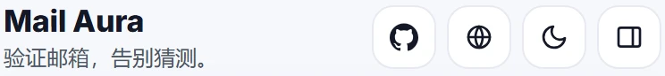
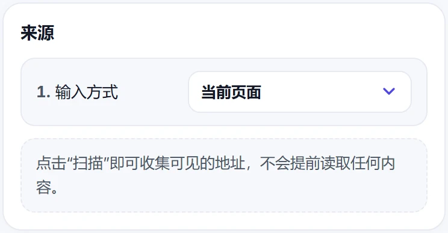
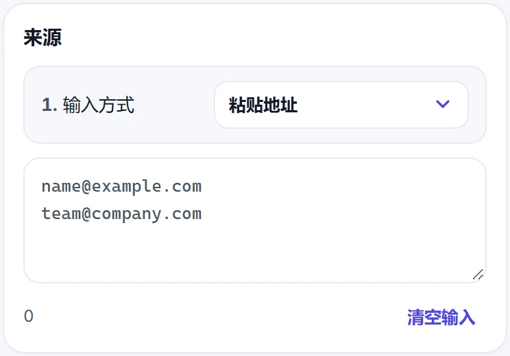
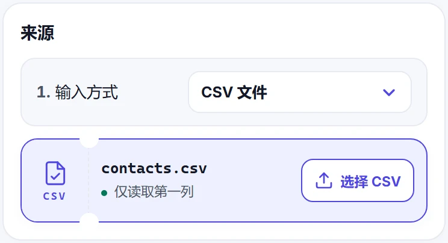
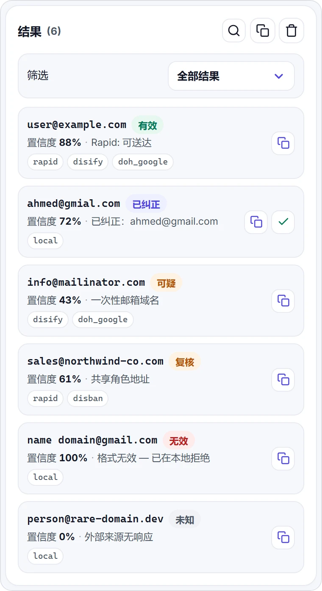
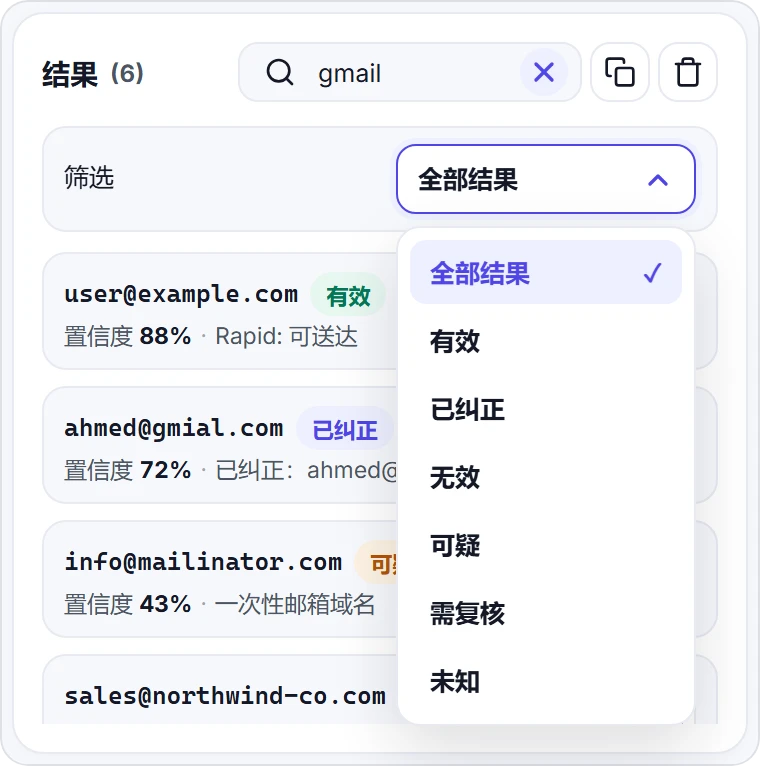
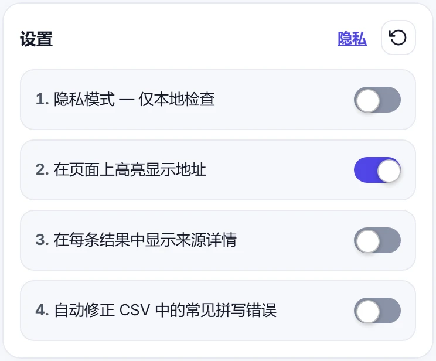
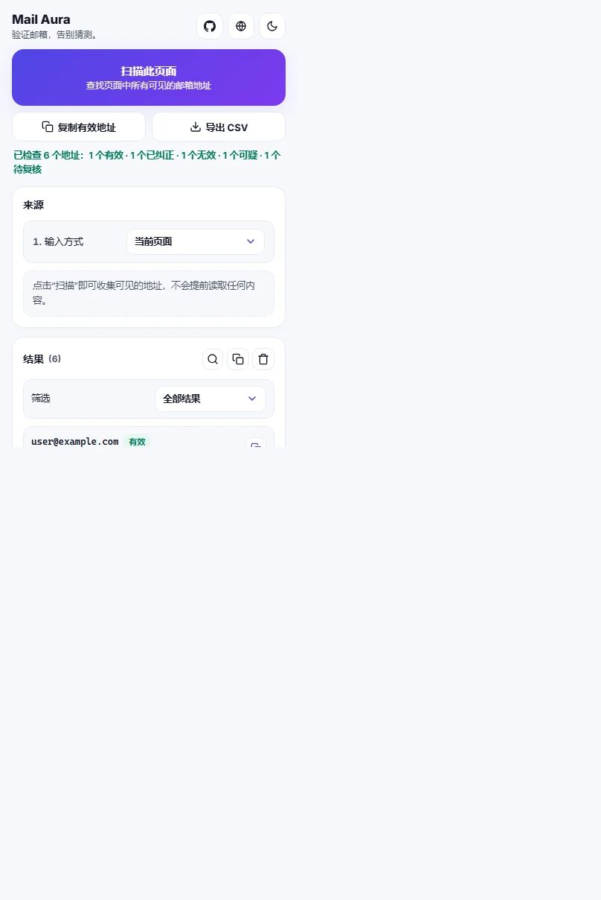
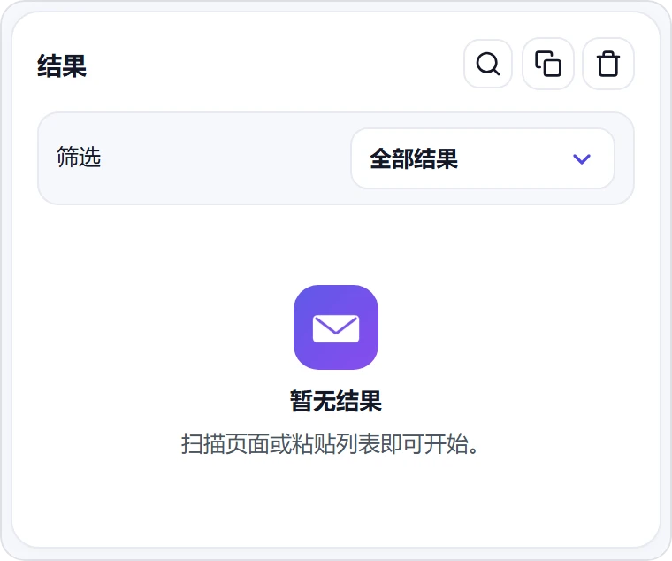

  

<h1 align="center">Mail Aura — 邮箱验证与列表清理工具</h1>

通过八个免费的公开来源验证电子邮件地址，一键清理长列表，并将结果导出为 CSV —— 无需 API 密钥、无需账户、无需猜测。界面提供八种语言，包括完整的阿拉伯语 RTL 支持。

  
  
  
  
  
  

<h4 align="center">
  <a href="README.md">English</a> · <a href="README.es.md">Español</a> · <a href="README.fr.md">Français</a> · <a href="README.de.md">Deutsch</a> · <a href="README.pt-BR.md">Português (Brasil)</a> · <a href="README.ru.md">Русский</a> · <a href="README.ar.md">العربية</a> · <a href="README.zh-CN.md"><b>中文（简体）</b></a>
</h4>
<h3 align="center">Download for your browser — click the icon</h3>

| [ <b>Chrome</b>](https://github.com/el9a7rawi/Mail-Aura/releases/latest) | [ <b>Edge</b>](https://github.com/el9a7rawi/Mail-Aura/releases/latest) | [ <b>Firefox</b>](https://github.com/el9a7rawi/Mail-Aura/releases/latest) | [ <b>Brave</b>](https://github.com/el9a7rawi/Mail-Aura/releases/latest) | [ <b>Opera</b>](https://github.com/el9a7rawi/Mail-Aura/releases/latest) |

Chrome 和 Chromium 浏览器是主要目标。从 140 版起通过专用归档提供 Firefox 支持，其中包含专属清单（侧边栏操作和经典后台脚本）。
|---|---|---|---|---|

---

## 1. 为什么选择 Mail Aura？

| 没有 Mail Aura | 使用 Mail Aura |
|---|---|
| 仅凭格式猜测 | 八个独立来源加上本地信号 |
| 粘贴的列表充满重复项 | 验证前先去除重复项 |
| 手动清理 CSV | 一键导入和导出 CSV |
| 毫无意义的 100% 徽章 | 诚实的评分，有效地址上限为 88% |

没有任何公共服务能够在不发送真实邮件的情况下证明某个特定邮箱确实存在。因此，Mail Aura 报告的是**置信度评分**，而非保证。

---

## 2. 工作原理 —— 三个步骤

1. **选择来源** —— 扫描当前页面、粘贴列表或加载 CSV。
2. **验证** —— 地址会通过八个免费服务并行检查，并按域名缓存。
3. **操作** —— 复制有效地址、一键纠正拼写错误，或将全部内容导出为 CSV。

---

## 3. 界面导览 — 扩展的每个部分

### 3.1 顶部栏 — 触手可及

标题、语言选择器、主题切换、GitHub 链接和侧边栏按钮都在同一行紧凑排列。

### 3.2 一个主操作

一个渐变按钮完成当前来源的工作。下方**复制有效地址**和**导出 CSV**一键可达；结果工具栏还提供**复制显示的结果**、**清除结果**以及每行一个复制按钮。状态行准确说明发生了什么。

### 3.3 来源 — 当前页面

只扫描您正在阅读的页面上可见的地址。按下按钮前不会读取任何内容。

### 3.4 来源 — 粘贴的列表

每行粘贴一个地址，或用逗号分隔。重复项在验证前被去除，格式错误的行仍作为结果显示。

### 3.5 来源 — CSV 文件

文件卡片显示图标和所选文件名。只读取第一列，因此即使导出文件杂乱也能正常工作。

### 3.6 结果 — 产品的核心

每行显示地址、彩色状态徽章、一行原因和行内操作。可选来源标签显示实际响应的来源标识。

### 3.7 筛选与搜索

七种筛选状态与可展开的搜索框协同工作；80 毫秒防抖让输入保持流畅。

### 3.8 右键菜单验证

在任何页面选中一个电子邮件地址或 `mailto:` 链接，然后选择**验证此电子邮件地址**。结果在弹出窗口中打开，并遵循隐私模式：启用时不会发起任何外部调用。

### 3.9 设置

隐私模式、页面高亮、来源标签和可选的 CSV 自动更正都是明确开关。自动更正默认关闭，只修正上传 CSV 中已知域名拼写错误；绝不猜测未知错误。切换隐私模式还会清除内存中的域名缓存。

### 3.10 八种语言与真正的 RTL

即时切换 English、Español、Français、Deutsch、Português (Brasil)、Русский、العربية 和 中文（简体）。阿拉伯语按逻辑而非表面完整地翻转整个布局。

### 3.11 纯黑深色主题

真正的纯黑背景，经过对比度调优，从顶部栏切换并在会话间记住。

### 3.12 长列表侧边栏

相同的控制器、更宽的画布和单一滚动容器 — 没有嵌套滚动条。

### 3.13 空状态

诚实地邀请您扫描或粘贴，绝不是空白框。

### 3.14 支持持续开发

Mail Aura 免费且开源。PayPal 和醒目的 InstaPay 选项帮助持续改进。两者都在新标签页打开；扩展不发送任何数据。
## 4. 八个免费来源

1. Rapid Email Validator
2. Disify
3. DeBounce
4. MailCheck.ai
5. Disban
6. EmailProbe
7. Google DNS-over-HTTPS
8. Cloudflare DNS-over-HTTPS

所有调用均使用 HTTPS 且无需密钥。隐私模式会禁用所有这些调用。

---

## 5. 安装（未打包）

1. 打开 `chrome://extensions`。
2. 启用**开发者模式**。
3. 点击**加载已解压的扩展程序**，然后选择此文件夹。
4. 点击工具栏中的 Mail Aura 图标。

无需构建步骤，也无需任何外部依赖。

---

## 6. 开发

发布的仓库只包含扩展及其文档。开发样例、辅助脚本和本地测试套件有意不纳入仓库；每次 push 时 GitHub Actions 都会校验清单、CSP、语言覆盖和随附资源。

---

## 7. 隐私

请参阅 `privacy.html`。仅在您请求时发送地址，不进行任何跟踪，所有连接均使用 HTTPS。上下文菜单结果短暂保存在 storage.session 中。字体已随扩展本地打包。

---

## 8. 许可证

本项目开源，任何人均可免费使用，采用 **Apache-2.0** 许可证 —— 您可以自由使用、修改和分享；完整文本见 [LICENSE](LICENSE)。

---

由 <b>Ahmed Yousry</b> 用心打造 · <a href="https://github.com/el9a7rawi/Mail-Aura">Mail Aura</a> · <a href="LICENSE">Apache-2.0</a>

