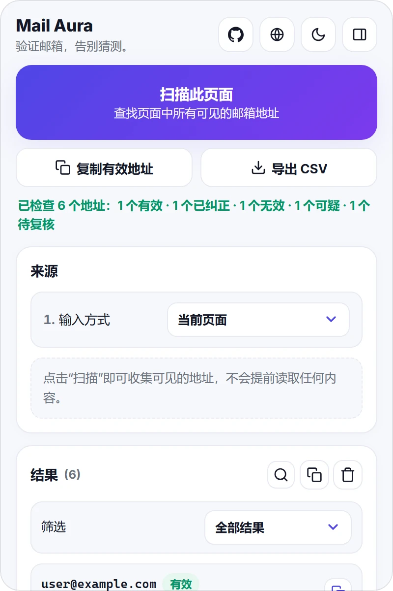
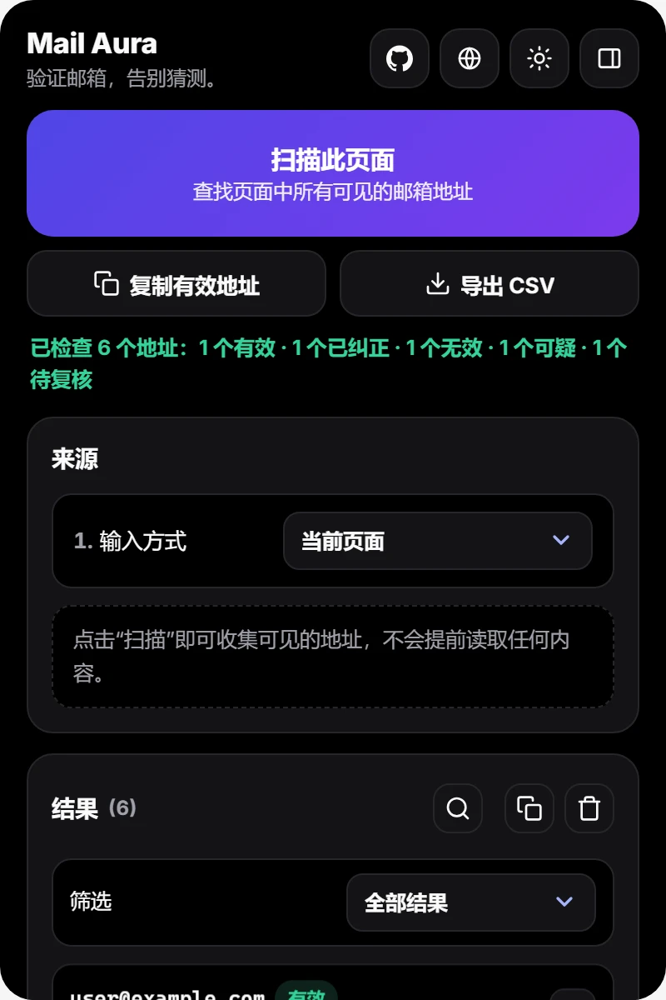
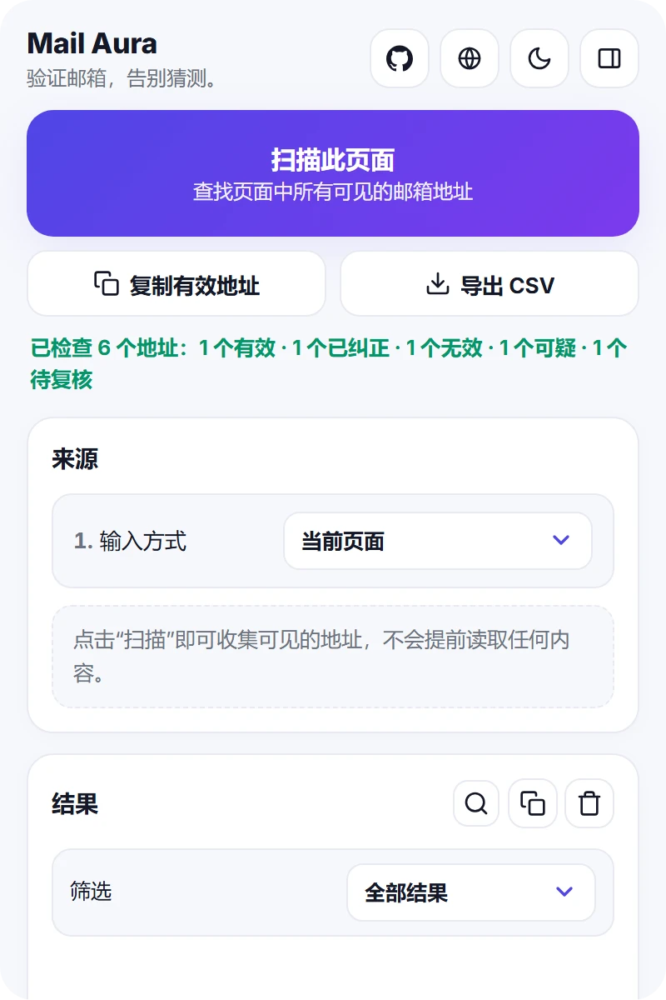
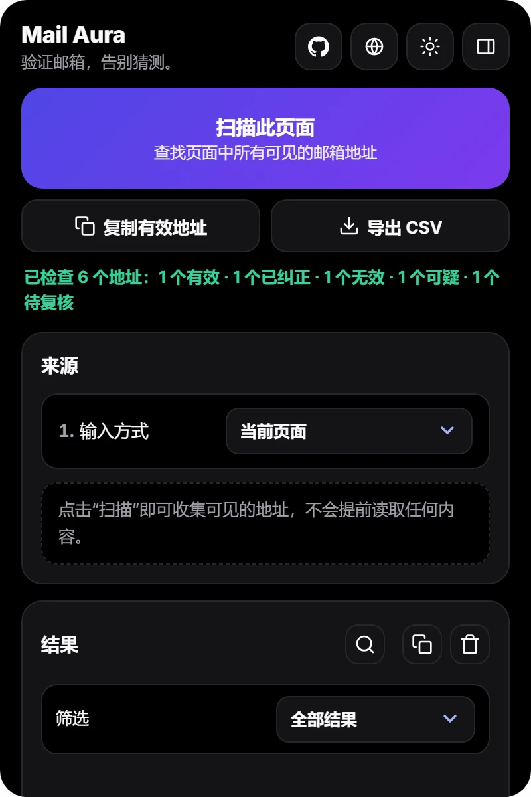

<p align="center">
  
</p>

<h1 align="center">Mail Aura — 邮箱验证与列表清理工具</h1>

<p align="center">通过八个免费的公开来源验证电子邮件地址，一键清理长列表，并将结果导出为 CSV —— 无需 API 密钥、无需账户、无需猜测。界面提供八种语言，包括完整的阿拉伯语 RTL 支持。</p>

<p align="center">
  <a href="https://github.com/el9a7rawi/Mail-Aura/releases"></a>
  <a href="https://github.com/el9a7rawi/Mail-Aura/blob/main/LICENSE"></a>
  <a href="https://github.com/el9a7rawi/Mail-Aura/pulls"></a>
  <a href="https://developer.chrome.com/docs/extensions"></a>
  
  
</p>

<p align="center">
  <sub><b>语言：</b> <a href="README.md">English</a> · <a href="README.es.md">Español</a> · <a href="README.fr.md">Français</a> · <a href="README.de.md">Deutsch</a> · <a href="README.pt-BR.md">Português (Brasil)</a> · <a href="README.ru.md">Русский</a> · <a href="README.ar.md">العربية</a> · <a href="README.zh-CN.md"><b>中文（简体）</b></a></sub>
</p>
<h3 align="center">Download for your browser — click the icon</h3>

<div align="center">

| [<br><b>Chrome</b>](https://github.com/el9a7rawi/Mail-Aura/releases/latest) | [<br><b>Edge</b>](https://github.com/el9a7rawi/Mail-Aura/releases/latest) | [<br><b>Firefox</b>](https://github.com/el9a7rawi/Mail-Aura/releases/latest) | [<br><b>Brave</b>](https://github.com/el9a7rawi/Mail-Aura/releases/latest) | [<br><b>Opera</b>](https://github.com/el9a7rawi/Mail-Aura/releases/latest) |
|---|---|---|---|---|

</div>


<p align="center">
  
  
</p>

<p align="center">
  
  
</p>

---

## 1. 为什么选择 Mail Aura？

<div align="center">

| 没有 Mail Aura | 使用 Mail Aura |
|---|---|
| 仅凭格式猜测 | 八个独立来源加上本地信号 |
| 粘贴的列表充满重复项 | 验证前先去除重复项 |
| 手动清理 CSV | 一键导入和导出 CSV |
| 毫无意义的 100% 徽章 | 诚实的评分，有效地址上限为 88% |

</div>

没有任何公共服务能够在不发送真实邮件的情况下证明某个特定邮箱确实存在。因此，Mail Aura 报告的是**置信度评分**，而非保证。

---

## 2. 工作原理 —— 三个步骤

1. **选择来源** —— 扫描当前页面、粘贴列表或加载 CSV。
2. **验证** —— 地址会通过八个免费服务并行检查，并按域名缓存。
3. **操作** —— 复制有效地址、一键纠正拼写错误，或将全部内容导出为 CSV。

---

## 3. 界面导览

### 3.1 一个主操作，三种输入模式
- **扫描此页面** —— 收集可见地址并高亮显示，无需事先读取页面。
- **粘贴地址** —— 每行一个或以逗号分隔；重复项会被去除，无效语法会作为结果显示。
- **CSV 文件** —— 读取第一列，并导出一个新的 CSV，其中包含状态、置信度、一致性、建议和来源详情。

### 3.2 值得信赖的结果
- 每一行显示地址、状态徽章和一行简短详情：`置信度 N% · 原因`。
- 按状态筛选、在结果中搜索，以及复制有效或可见的行。
- 一键修正已知的域名拼写错误，例如 `gmial.com → gmail.com`。
- 一次性域名、职能邮箱和免费邮箱服务商会被标记，而非隐藏。

### 3.3 隐私模式
- 立即停止所有外部调用；验证变为仅本地进行。
- 页脚的连接指示器始终显示当前状态。

### 3.4 八种语言，真正的 RTL
- 英语为默认语言；首次运行时，若浏览器语言属于这八种语言之一，则采用该语言。
- 切换即时生效，无需重新加载。
- 阿拉伯语采用完整的 RTL 布局，并遵循正确的复数规则。

### 3.5 纯黑深色主题
- 真正的纯黑背景，经过对比度调校，可从顶部栏切换并记住设置。

### 3.6 Support continued development

- Mail Aura 免费且开源。可选的 InstaPay 按钮和 PayPal 备选有助于持续改进。两个链接都在新标签页打开，扩展不会发送任何数据。

---

## 4. 八个免费来源

1. Rapid Email Validator
2. Disify
3. DeBounce
4. MailCheck.ai
5. Disban
6. EmailProbe
7. Google DNS-over-HTTPS
8. Cloudflare DNS-over-HTTPS

所有调用均使用 HTTPS 且无需密钥。隐私模式会禁用所有这些调用。

---

## 5. 安装（未打包）

1. 打开 `chrome://extensions`。
2. 启用**开发者模式**。
3. 点击**加载已解压的扩展程序**，然后选择此文件夹。
4. 点击工具栏中的 Mail Aura 图标。

无需构建步骤，也无需任何外部依赖。

---

## 6. 开发

```powershell
node --test tests/             # 49 个单元测试
node --check ui.js             # 检查所有 JS 文件的语法
node scripts/check-ui.mjs      # 检查 DOM ID、清单文件、CSP、HTTPS
node scripts/build-preview.mjs # 重新生成 dev/preview.html 和 preview-side.html
```

截图辅助工具需要 Chrome：

```powershell
node scripts/screenshot.mjs --url "file:///C:/.../dev/preview.html?theme=light&tall=1" --out dev/preview-light.png
```

---

## 7. 隐私

请参阅 `privacy.html`。仅当您请求验证时才会发送地址，不会进行任何跟踪，所有连接均使用 HTTPS。唯一声明的例外是界面打开时加载的一份 Google Fonts 样式表；其中不会发送任何电子邮件或验证数据。

---

## 8. 许可证

本项目开源，任何人均可免费使用，采用 **Apache-2.0** 许可证 —— 您可以自由使用、修改和分享；完整文本见 [LICENSE](LICENSE)。

---

<p align="center">由 <b>Ahmed Yousry</b> 用心打造 · <a href="https://github.com/el9a7rawi/Mail-Aura">Mail Aura</a> · <a href="LICENSE">Apache-2.0</a></p>
